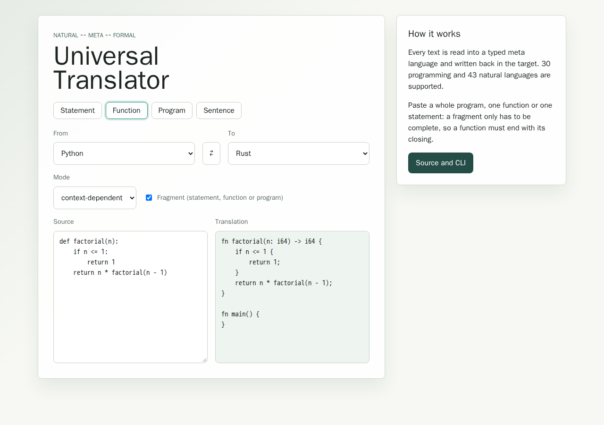

# @link-foundation/universal-translator

Translate programs between languages through a typed meta language, with
matching JavaScript and Rust implementations. The translator is built from
grammar and rule tables, not from per-program templates. It reads JavaScript,
TypeScript, Python, Ruby, Lua, PHP, C, C++, C#, Java, Go, Rust, Kotlin,
Swift, Perl, Dart, Scala, Julia, R, Groovy, Objective-C, Nim, D, Pascal,
Fortran, Ada, Visual Basic .NET, Bash, MATLAB/Octave, Zig, Lean 4 and Rocq
(32 languages), and writes any of them. It can also lower a program to x86-64
assembly (NASM or GNU as, AT&T), ARM64 assembly, CIL (ILAsm), JVM bytecode
(Jasmin), LLVM IR or WebAssembly text. These machine targets appear in
`languages()` flagged `machine: true`, after the programming languages.

## Translate a program

```sh
npm ci
node bin/universal-translator.js translate javascript python examples/programs/factorial.js
node bin/universal-translator.js translate python rust - < program.py
node bin/universal-translator.js translate javascript nasm examples/programs/fizz-buzz.js
node bin/universal-translator.js meta go examples/programs/hand-written/sum-of-squares.go
node bin/universal-translator.js languages
cargo run --locked -- translate-grammar javascript kotlin examples/programs/factorial.js
```

Both CLIs read a file, or standard input when you omit the file or pass `-`.
The JavaScript package supports Node.js 20 and later, Bun and Deno.

Each translation runs these stages:

1. A lexer and a table-driven parser read the source language.
2. Understanding rules turn the syntax tree into a meta program.
3. Type inference gives every value a type.
4. Meaning rules and any configured meta→meta layers rewrite the program.
5. Context rules adapt it to the target language.
6. An emitter writes the target syntax. For the machine targets, the program
   is first lowered to a stack machine.

Pick a mode with `--mode`:

- `context-dependent` (the default) adapts names, comments and terms such as
  "function" or "method" to the target language.
- `literal` keeps names and comment text as written.
- `same-effect` keeps only what the program does and may restructure it.

The meta language has integers, text, booleans and integer arrays. Arrays
are indexed from 0 in the meta language, and languages that count from 1
shift every index. In C an array is a local variable-length array, so its
length is `sizeof a / sizeof a[0]`. The sieve, bubble sort and sum and
product examples use arrays. The case study lists the other compromises.

`createTranslator({ layers })` takes rule layers that can be replaced or
decorated. The common library in `common-library/` only hides differences
between standard libraries, such as printing. `--common-library` translates
every print into a call to it.

Every program in `examples/programs` has been translated into every target
in `examples/programs/translated`. These shared files are what the JavaScript
and Rust tests check against. `node examples/programs/verify-native.mjs`
compiles and runs each translation with its native toolchain, and CI runs it
with `--require-all`.

## Translate a statement or a function on its own

A fragment is a whole program, one or more function definitions, or one or
more statements. `parseFragment` tries the source in that order and
returns its kind. `translateFragment` writes the same kind of fragment
in the target, without a main function, a class or imports.

```js
import {
  parseFragment,
  translateFragment,
} from '@link-foundation/universal-translator';

parseFragment('x = x + 1;', 'javascript').kind; // 'statements'
translateFragment('x = x + 1;', 'javascript', 'pascal'); // 'x := x + 1;\n'
translateFragment('def square(n):\n    return n * n\n', 'python', 'rust');
// 'fn square(n: i64) -> i64 {\n    return n * n;\n}\n'
```

```sh
echo 'x = x + 1;' | node bin/universal-translator.js translate javascript pascal --fragment
```

The Rust crate has `parse_fragment` and `translate_fragment`, as free
functions and as methods of `Translator`, and its command line has the same
`--fragment` flag. A fragment must be complete. A function ends with its
closing, a block statement with its end, and a single line statement is a
whole statement. Otherwise the error says what is missing and where, for
example `The fragment is not complete: it ends before its closing (line 2)`.

Every fragment in `examples/programs/fragments` is translated into every
language under `examples/programs/fragments/translated`. Both test suites
check these files and read each of them back into the same JavaScript.

Limits:

- Variables that the fragment uses but does not declare stay undeclared.
  Pascal, Fortran and Ada only declare the variables that the fragment
  declares itself, and keep the spelling of the others as written. In Zig
  such a variable is printed with `{any}`.
- In Python, Ruby and other languages without declarations, `x = 5` is read
  as a declaration.
- In a natural language, a fragment is one or more sentences that match a
  template of the language.
- Machine targets (NASM, GNU as, ARM64, CIL, JVM, LLVM IR, WebAssembly text) hold whole programs only. A statement or
  function on its own is rejected.
- Perl and Bash have no booleans, so `true` and `false` come back as 1 and 0.
- Classes are not part of the meta language yet.

## Translate to and from controlled natural languages

Controlled versions of 30 natural languages are languages like any other.
They are English, Chinese, Hindi, Spanish, French, Arabic, Bengali,
Portuguese, Russian, Urdu, Indonesian, German, Japanese, Marathi, Telugu,
Turkish, Tamil, Vietnamese, Korean, Italian, Persian, Swahili, Tagalog,
Thai, Polish, Ukrainian, Hausa, Gujarati, Punjabi and Dutch. Each one is
described as data in `data/natural/<id>.lino`: one sentence template for
every meta statement, one phrase for every operator, and a small lexicon
for program names. The writer and the reader use the same tables, so every
sentence the writer produces is one the reader accepts.

```sh
node bin/universal-translator.js translate javascript russian examples/programs/fizz-buzz.js
node bin/universal-translator.js translate english rust examples/programs/natural/factorial/factorial.english.txt
node bin/universal-translator.js translate nasm minimal-english examples/programs/translated/factorial/factorial.asm
node bin/universal-translator.js check-words english-e-prime examples/programs/natural/leap-year/leap-year.english-e-prime.txt
```

```text
Для каждого число от 1 до 100 повторять это:
  Если число по модулю 15 равно 0, сделать это:
    Написать «FizzBuzz» и закончить строку.
```

Profiles extend a language and add the rules of a controlled language
standard. `checkText` and `check-words` enforce those rules:

| Profile                   | Standard                                     | Rules that are checked                                |
| ------------------------- | -------------------------------------------- | ----------------------------------------------------- |
| `english` (`cnl-default`) | Balanced intersection of the standards below | One-to-one single-word lexicon; every text reads back |
| `english-asd-ste100`      | ASD-STE100 Simplified Technical English      | At most 20 words, imperative starts, word list        |
| `english-ace`             | Attempto Controlled English                  | Sentences start with ACE's determiners and keywords   |
| `english-gellish`         | Gellish Formal English                       | Templates use each listed Gellish relation phrase     |
| `dutch-gellish`           | Gellish Formeel Nederlands                   | Templates use each listed Gellish relation phrase     |
| `english-sbvr`            | SBVR Structured English                      | Sentences start with SBVR keywords                    |
| `english-plain-language`  | Plain language (ISO 24495-1)                 | At most 25 words, 20 on average; no "shall"           |
| `english-e-prime`         | E-Prime                                      | No form of "to be"                                    |
| `english-basic-english`   | Basic English (Ogden's 850 words)            | At most 25 words; template words from Ogden's list    |
| `english-special-english` | VOA Special English / Learning English       | Template words from its word list, short sentences    |
| `english-globish`         | Globish                                      | At most 20 words; template words from Globish list    |
| `minimal-english`         | Minimal English (NSM)                        | Template words are semantic primes or molecules       |
| `minimal-french`          | Minimal French (NSM)                         | Template words are semantic primes or molecules       |
| `minimal-polish`          | Minimal Polish (NSM)                         | Template words are semantic primes or molecules       |

The 65 semantic primes of Natural Semantic Metalanguage are listed in
`data/natural/semantic-primes.lino` with their English, French, Polish,
Russian and Spanish exponents. Every example program is written in every
language and profile in `examples/programs/natural`. The tests read each
text back to the same meaning, check it against the rules of its standard
and translate it to every programming language. The Rust implementation
(`rust/src/natural/`) reads the same data, writes the same texts byte for
byte and has the same `languages` and `check-words` commands.

`node scripts/check-requirements.mjs` checks every requirement of issue 1
against `docs/case-studies/issue-1/requirements.lino`, and CI fails while any
of them is neither done nor reported as blocked.

See the [runnable examples](examples/translation/README.md) and the
[issue 1 case study](docs/case-studies/issue-1/README.md).

## Library, CLI, HTTP API and Docker

The same translator is available four ways:

```js
import {
  createTranslator,
  createTranslationServer,
} from '@link-foundation/universal-translator';

createTranslator().translate('console.log("Hi");', 'javascript', 'python');
createTranslationServer().listen(8080); // GET /languages, POST /translate
```

```bash
universal-translator translate javascript python app.js
universal-translator serve --port 8080   # or PORT=8080, or PORT: 8080 in .lenv
curl -d '{"source":"console.log(\"Hi\");","from":"javascript","to":"rust"}' \
  -H 'content-type: application/json' http://localhost:8080/translate
docker build -t universal-translator .
docker run --rm -p 8080:8080 universal-translator          # the HTTP API
docker run --rm -i universal-translator translate javascript go - < app.js
```

`POST /translate` takes `{source, from, to, fragment?, mode?, commonLibrary?,
allOrNothing?, rules?}` and answers `{output, complete, errors, coverage?,
detected?}`, or `{error}` with status 400. Regular expression rules are refused unless the
server is created with `createTranslationServer({ allowRegexRules: true })`.

### Partial translation, detection and rules

Translation is partial by default. Whatever reads is translated, and every
part that does not is kept as a comment with its error:

```bash
universal-translator translate auto javascript app.py   # detect the source
universal-translator translate python go app.py --all-or-nothing
universal-translator coverage python app.py   # lines:, readLines:, coverage:, errors:, parts:
universal-translator detect app.py            # the likeliest languages first, one per line
universal-translator detect app.py --json     # either report as JSON
universal-translator translate russian python a.txt --rules examples/rules/russian-at-most.lino
```

```js
import {
  createTranslator,
  detectLanguage,
  translatePartial,
} from '@link-foundation/universal-translator';

translatePartial(
  'x = 1\nwith open(f) as g:\n    y = 2\n',
  'python',
  'javascript'
);
// { text, complete: false, errors: [{ line: 2, endLine: 2, message }], coverage }
detectLanguage('fn main() {}\n')[0].id; // 'rust'

// Rules as data, one list per stage of the pipeline:
createTranslator({
  rules: {
    source: [{ find: 'ничего', replace: 'Ничего', language: 'russian' }],
    templates: {
      russian: { 'less-or-equal': ['{left} самое большее {right}'] },
    },
    names: [{ find: 'n', replace: 'count' }],
    output: [{ find: '(\\d+)', replace: '[$1]', regex: true }],
  },
});
```

A rule file is indented Links Notation. A stage, a natural language and a
template key are unique, so each is written as `name:`. The rules of a
stage are a list with one rule per line, each made of a few `(field value)`
links. `readRules` and `formatRules` (Rust: `custom_rules::read_rules` and
`format_rules`) turn the text into the object above and back, and JSON rule
files are still read. This is
[examples/rules/russian-at-most.lino](examples/rules/russian-at-most.lino):

```
source:
  (find ничего) (replace Ничего) (language russian)
templates:
  russian:
    less-or-equal: '{left} самое большее {right}'
names:
  (find n) (replace count)
output:
  (find pass) (replace 'pass  # ничего') (language python)
  (find '(\d+)') (replace '[$1]') (regex true) (language javascript)
```

`POST /translate` takes `rules` as this text or as the object.

### Layout: the source's whitespace, by default

Partial translation (the default of the command line, the server and the
web demo) keeps the concrete layout of the source wherever the target has
the same tokens: the spaces inside a line, the step of indentation, the
blank lines, the blank lines around the code and the line ends. It also
returns `lineMap`, the 0-based `[source line, target line]` pairs that the
web demo uses to keep both editors in step. `--layout target` (`layout:
'target'`) writes the layout of the target's emitter instead:

```bash
printf '\nconsole.log( "Hello World!");\n\nconsole.log(1+ 2);\n' > hello.js
universal-translator translate javascript python hello.js
# (blank line)
# print( "Hello World!")
# (blank line)
# print(1+ 2)
universal-translator translate javascript python hello.js --layout target
```

Spaces that would join two tokens (`u "x"`), make a call a grouping
(`f (x)`), or sit next to `.`, `:` and the like are left as the target
writes them, and Bash keeps its own spacing. `examples/layout/` holds the
examples both implementations are checked against; see the
[issue 14 case study](docs/case-studies/issue-14/README.md).

### Language versions, comment languages and the meta view

A target may name a version of a language (`python@2`, `english-british`,
`minimal-russian`). Comments are kept with their spacing, as in a concrete
syntax tree, and may be translated to another natural language on their
own. When `--comment-from` is left out, the comment language is detected:

```bash
universal-translator translate javascript python@2 app.js --comment-language russian
universal-translator translate python python app.py --comment-language german  # comments only
universal-translator meta python app.py   # the meta language as an indented tree
universal-translator meta python app.py --json   # the same program as JSON
```

The meta view is indented Links Notation: one line per node with its kind,
its main value and its other plain fields as `(name value)` links, and its
child nodes nested below it with no field labels and no block markers. A
field that follows a block, such as the `else` branch, is introduced by one
plain word (`otherwise`):

```
program
  function twice (blank-after true) (return-type integer)
    parameter n (type integer)
    if
      binary greater (type boolean)
        name n (type integer)
        number 1 (type integer)
      return
        binary multiply (type integer)
          name n (type integer)
          number 2 (type integer)
      otherwise
        return
          number 0 (type integer)
  call print-line (library standard)
    call twice (type integer)
      number 3 (type integer)
```

The meta view shows a program in its general form. Printing a line and
taking the length of an array are no special parts of the meta language:
they are calls to procedures of its standard library (`print-line`,
`print`, `length`), each of which every target spells in its own way
(`console.log`, `print`, `printf`, `len`, `.length`, ...). `generalize`
and `specialize` move a meta program between this general form and the
concepts the emitters work on, and `fromMeta` accepts either form:

```js
import { generalize, specialize } from '@link-foundation/universal-translator';

const meta = translator.toMeta(
  'numbers = [1, 2]\nprint(len(numbers))\n',
  'python'
);
const general = generalize(meta);
// Evaluate { Call print-line (library standard) [Call length (library standard) [numbers]] }
translator.fromMeta(general, 'c'); // printf("%d\n", (int) (sizeof numbers / sizeof numbers[0]));
specialize(general); // the same program as toMeta wrote it
```

The `meta` command also reads comments and strings with the grammars
they are written in (`--shallow` leaves them as plain text;
`nestGrammars` / `nest_grammars` do the same in code). A comment is read
as prose of the natural language most of its words belong to: its
sentences, its words and the concepts, semantic primes or program words
they stand for. Code quoted between backticks, and a string that one of
the programming languages reads whole, is read as a nested program. A
text longer than twelve words is written once in the `texts` of the
program and referred to by id from every comment and string that holds
it. `unnest` gives back the plain program, and `fromMeta` accepts the
nested form too:

```
program
  paragraph text-1 (text 'This program reads a list of numbers, adds them and prints the sum of all of them')
    prose english
      sentence
        word This (part prime) (prime this)
        word program (concept program) (part noun)
        word reads (concept read) (part verb)
        ...
  comment 'Prints `x + 1`'
    prose english
      sentence
        word Prints (concept print) (part verb)
        code javascript
          program
            evaluate
              binary add (type integer)
                name x
                number 1 (type integer)
  declaration x (mutable false) (type integer)
    number 1 (type integer)
  call print-line (library standard)
    binary add (type integer)
      name x (type integer)
      number 1 (type integer)
  comment (reference text-1)
```

```js
import {
  createTranslator,
  formatMeta,
  translateComments,
  versionsOf,
  naturalLanguageVersions,
} from '@link-foundation/universal-translator';

const translator = createTranslator();
translator.translate('// number\nlet x = 1;\n', 'javascript', 'python@2', {
  commentLanguage: 'russian',
}); // '# число\nx = 1\n'
translateComments('# number\nx = 1\n', 'python', { to: 'russian' });
formatMeta(translator.toMeta('x = 1\n', 'python'));
versionsOf('python'); // [{ version: '3', default: true }, { version: '2' }]
naturalLanguageVersions('english'); // regions, standards and minimal-english
```

Every natural language has a `minimal-<id>` version restricted to the 65
semantic primes of Natural Semantic Metalanguage. `createStandard`,
`defineWord` and `wikidataLookup` build a standard of at most 1024 words
whose other words are defined recursively through it. The web demo edits
standards and settings, and switches between the languages on both sides.
The Rust crate has the same versions, comment languages and
`--comment-language`/`--comment-from` flags. See the
[issue 6 case study](docs/case-studies/issue-6/README.md).

The web demo detects the source language by default, lists the untranslated
parts and edits the same rules visually. `node scripts/rosetta-code.mjs all`
measures coverage over every Rosetta Code task; see the
[issue 8 case study](docs/case-studies/issue-8/README.md). Pull requests build the
image and smoke test both the CLI and the API inside it.

## Features

- **Multi-runtime support**: Works with Bun, Node.js, and Deno
- **Universal testing**: Uses [test-anywhere](https://github.com/link-foundation/test-anywhere) for cross-runtime tests
- **Automated releases**: Changesets-based versioning with GitHub Actions
- **Optional Docker Hub publishing**: Docker images can be published after the matching npm version is visible
- **Universal app example**: React UI for the package API with GitHub Pages, Electron, and Capacitor build paths
- **Code quality**: ESLint + Prettier with pre-commit hooks via Husky
- **Package manager agnostic**: Works with bun, npm, yarn, pnpm, and deno
- **Broken link checks**: Automated link validation with [lychee](https://github.com/lycheeverse/lychee-action) and Web Archive fallback suggestions

## Quick Start

### Installation

```bash
npm install @link-foundation/universal-translator
npx @link-foundation/universal-translator --version
npx @link-foundation/universal-translator add 2 3
```

To check the version in this checkout, run `node bin/universal-translator.js --version`.

### Development

```bash
# Install dependencies
bun install

# Run tests
bun test --timeout 30000

# Or with other runtimes:
npm test
deno test -A --parallel

# Lint code
bun run lint

# Format code
bun run format

# Check all (lint + format + file size)
bun run check

# Build the universal React example app
npm install --prefix examples/universal-app
npm run example:web:build
npm run example:desktop:package

# Try the CLI locally
node bin/universal-translator.js add 2 3
```

## Project Structure

```
.
├── .changeset/           # Changeset configuration
├── .github/workflows/    # GitHub Actions CI/CD
├── .husky/               # Git hooks (pre-commit)
├── data/                 # Shared Links Notation data
├── examples/             # Usage examples
│   └── universal-app/    # React + GitHub Pages + Electron + Capacitor app
├── js/
│   ├── src/              # JavaScript library and TypeScript declarations
│   │   ├── meta/         # Shared meta language: tree, types, truth, Links Notation
│   │   ├── formal/       # Programming languages and machine code (parse, emit, lower, lift)
│   │   ├── natural/      # Human languages and controlled languages (read, write)
│   │   ├── translation/  # Source-preserving documents and referent ranking
│   │   └── translator.js # The pipeline that connects the three layers
│   └── tests/            # JavaScript and repository tooling tests
├── rust/
│   ├── src/              # Rust library and CLI, with the same meta/, formal/,
│   │                     # natural/ and translator.rs layout as js/src
│   └── tests/            # Rust integration tests
├── scripts/              # Build and release scripts
├── eslint.config.js      # ESLint configuration
├── .prettierrc           # Prettier configuration
├── bunfig.toml           # Bun configuration
├── Cargo.toml            # Rust package manifest
├── deno.json             # Deno configuration
└── package.json          # Node.js package manifest
```

## Design Choices

### Multi-Runtime Support

This template is designed to work seamlessly with all major JavaScript runtimes:

- **Bun**: Primary runtime with highest performance, uses native test support (`bun test`)
- **Node.js**: Alternative runtime, uses built-in test runner (`node --test`)
- **Deno**: Secure runtime with built-in TypeScript support (`deno test`)

The [test-anywhere](https://github.com/link-foundation/test-anywhere) framework provides a unified testing API that works identically across all runtimes.

### Package Manager Agnostic

While `package.json` is the source of truth for dependencies, the template supports:

- **bun**: Primary choice, uses `bun.lockb`
- **npm**: Uses `package-lock.json`
- **yarn**: Uses `yarn.lock`
- **pnpm**: Uses `pnpm-lock.yaml`
- **deno**: Uses `deno.json` for configuration

Note: `package-lock.json` is not committed by default to allow any package manager.

### Universal App Example

`examples/universal-app` is a Vite React demo of the translator: pick any of
the programming or natural languages on both sides, paste a statement, a
function or a whole program, and read its translation (or the reason it does
not parse). The `web-e2e` job drives it in Chromium with
`examples/universal-app/e2e/translate.e2e.mjs`.



The same static build is used by:

- GitHub Pages (`npm run example:web:build`)
- Electron desktop packaging (`npm run example:desktop:package`)
- Capacitor Android/iOS sync (`npm run example:mobile:sync`)

The example app has its own `package.json` and lockfile so template users can
opt into the frontend stack without adding React, Electron, or Capacitor to the
library package itself.

See [examples/universal-app/README.md](examples/universal-app/README.md) for
local web, desktop, Android, and iOS testing instructions.

### Code Quality

- **ESLint**: Configured with recommended rules + Prettier integration
- **Prettier**: Consistent code formatting
- **Husky + lint-staged**: Pre-commit hooks ensure code quality
- **File size limit**: Files must stay under 1500 lines for maintainability (enforced via ESLint and CI)

### Release Workflow

The release workflow uses [Changesets](https://github.com/changesets/changesets) for version management:

1. **Creating a changeset**: Run `bun run changeset` to document changes
2. **PR validation**: CI checks for valid changeset in each PR
3. **Automated versioning**: Merging to `main` triggers version bump
4. **npm publishing**: Automated via OIDC trusted publishing (no tokens needed)
5. **Optional Docker Hub publishing**: When configured, waits for the exact npm version and tags the Docker image with that version
6. **GitHub releases**: Auto-created with formatted release notes

#### First release and trusted publisher

The npm package name is `@link-foundation/universal-translator`. The repository must match the
package's `repository.url`: `https://github.com/link-foundation/universal-translator`.
The existing `.github/workflows/release.yml` is the publishing workflow for both
automated and manual releases; both publishing jobs grant `id-token: write`
and install npm with trusted publishing support.

To bootstrap an unpublished package with the existing token fallback, configure
repository secret `NPM_TOKEN` with a granular token that can create and publish
this public package (including bypass 2FA permission). The workflow passes it as
`NODE_AUTH_TOKEN`. Merge this PR and allow the pending changesets to produce the
first version through the normal release process.

In the npm package settings, attach a GitHub Actions trusted publisher with:

| Field                | Value                  |
| -------------------- | ---------------------- |
| Organization or user | `link-foundation`      |
| Repository           | `universal-translator` |
| Workflow filename    | `release.yml`          |
| Environment          | Leave empty            |
| Permission           | Allow `npm publish`    |

Follow the [npm trusted publishing instructions](https://docs.npmjs.com/trusted-publishers/)
for account setup. After attaching the publisher, remove the bootstrap token and
verify that Release Preflight reports a successful package-specific OIDC exchange.
The preflight reports missing permissions on PRs and fails explicitly on `main`
until publishing is configured.

Verify the released artifact from a clean directory:

```bash
npm view @link-foundation/universal-translator version
npx --yes @link-foundation/universal-translator --version
```

The release workflow also installs the exact published version and tests its
library and CLI entry points. See [release verification](docs/issue-2-release.md)
for the implementation checklist and remaining account-level setup.

#### Manual Releases

Two manual release modes are available via GitHub Actions:

- **Instant release**: Immediately bump version and publish
- **Changeset PR**: Create a PR with changeset for review

### CI/CD Pipeline

The GitHub Actions workflow (`.github/workflows/release.yml`) implements a fast-fail pipeline:

**Fast checks** (~7-30s each, run first for fastest feedback):

1. **Test compilation**: Syntax-checks all `.mjs` files with `node --check`
2. **Lint, format & secrets scan**: ESLint, Prettier, jscpd, and [secretlint](https://github.com/secretlint/secretlint) for credential leak detection
3. **File line limits**: Enforces the 1500-line limit on JavaScript (`.js`, `.mjs`, `.cjs`) and Markdown (`.md`) files plus `release.yml`
4. **Changeset check**: Validates PR has exactly one changeset (added by that PR)
5. **Version check**: Blocks manual version changes in `package.json`
6. **Documentation validation**: Checks required doc files (doc line limits are enforced by the file line limits check)

**Slow checks** (only run after all fast checks pass):

7. **Ubuntu tests**: Node.js, Bun, and Deno run in parallel with the Rust suite and cross-language output checks
8. **Broken link checks**: Validates all links in Markdown/HTML files (separate workflow)

**Release** (on merge to main):

9. **Changeset merge**: Combines multiple pending changesets at release time
10. **Release**: Automated versioning and npm publishing
11. **Optional Docker publish**: Publishes Docker Hub `latest` and npm-version tags after the npm package is visible

#### Reasonable Timeouts

Every CI job declares an explicit `timeout-minutes` so hung steps fail
in minutes instead of reaching the GitHub Actions default of six hours.
Fast checks use 5-10 minute caps, release jobs use 50 minutes, and the
link checker uses 10 minutes for external network variance.

That cap is a backstop, never the deadline: GitHub reports a job it
kills as **cancelled**, not **failed**. Long steps therefore own an
explicit budget via `scripts/run-with-budget-warning.sh`, which warns at
70% of the budget and fails the step with exit code 124 when it expires.
See [CI-TIMEOUT-BUDGETS.md](docs/CI-TIMEOUT-BUDGETS.md).

Individual tests are also capped inside supported runners:
`npm test` runs `node --test --test-timeout=30000`, and the CI Bun
runner uses `bun test --timeout 30000`. Both bound a _single test_, not
the suite, which is why the suite budget above exists. Deno does not
provide a single global per-test timeout flag, so Deno tests are
protected by their step budget and the matrix job backstop.

See [BEST-PRACTICES.md](docs/BEST-PRACTICES.md) for detailed explanations of each practice.

#### Robust Changeset Handling

The CI/CD pipeline is designed to handle concurrent PRs gracefully:

- **PR Validation**: Only validates changesets **added by the current PR**, not pre-existing ones from other merged PRs. This prevents false failures when multiple PRs merge before a release cycle completes.

- **Release-time Merging**: If multiple changesets exist when releasing, they are automatically merged into a single changeset with:
  - The highest version bump type (major > minor > patch)
  - All descriptions preserved in chronological order

This design decouples PR validation from the need to pull changes from the default branch, reducing conflicts and ensuring that even if CI/CD fails, all unpublished changesets will still get published when the error is resolved.

### Deploying the example app

The `example-app.yml` workflow publishes a downloadable web build on pull
requests and deploys the app to GitHub Pages on matching pushes to `main`.
For a new repository, open **Settings → Pages** and set **Source = GitHub
Actions**. When the site is missing or misconfigured, the main workflow
still uploads the web build and reports the setting to change in the
**Configure GitHub Pages** step. Re-run the failed jobs after updating it.

### Auto-regenerated preview screenshots

The same `example-app.yml` workflow contains a `preview-regen` job that boots
the built example app in a headless Chromium via
[`browser-commander`](https://www.npmjs.com/package/browser-commander) +
Playwright and writes fresh screenshots to
`docs/screenshots/example-app/example-app-{locale}-{theme}.png` on every
push to `main` (and on `workflow_dispatch`). Any drift is committed back to
`main` so README/site images never go stale between releases. Screenshot-only
pushes do not match this workflow's path filter, while a protected-branch
fallback PR remains eligible for its required checks. The job runs in the
official Playwright container with the browser already installed, avoiding CI
stalls from live Chromium downloads.

The same script is available locally:

```bash
npm install --prefix examples/universal-app
npm run example:web:preview-images
# Verbose probe of <html data-theme>, <html lang>, and PNG signatures:
PREVIEW_VERBOSE=1 npm run example:web:preview-images
```

The matrix defaults to `{en, ru} × {light, dark}`. The shipped example app
has no localization or theme toggle yet, so every cell currently renders
the same UI — when a fork adds either, the matrix produces real per-cell
variants without script edits.

### Broken Link Checker

The link checker workflow (`.github/workflows/links.yml`) validates all links in Markdown and HTML files:

1. **Detection**: Uses [lychee](https://github.com/lycheeverse/lychee-action) to scan all `*.md` and `*.html` files
2. **Web Archive fallback**: For any broken links found, automatically checks the [Wayback Machine](https://web.archive.org) for archived versions
3. **Actionable suggestions**: Reports one of three outcomes for each broken link:
   - **Archived**: Suggests the Web Archive URL as a replacement
   - **Not archived**: Clearly reports the link is unrecoverable
4. **Scheduled checks**: Runs weekly to catch links that break over time (even if no files changed)
5. **Issue creation**: On scheduled runs, creates a GitHub Issue with the full broken links report

Add regex patterns to `.lycheeignore` to exclude URLs from checks (e.g., local dev URLs, example.com, known rate-limited sites).

## Configuration

### Package Identity

`package.json` and `package-lock.json` use `@link-foundation/universal-translator`. The installed
command is `universal-translator`, provided by `bin/universal-translator.js`.
Release scripts derive the package name from `package.json` at runtime.

### Protected-Branch Release Pull Requests

If `main` requires pull requests and the `Pipeline Status` check, the release
and instant-release jobs can use their built-in `GITHUB_TOKEN` to open a release
PR. Enable **Allow GitHub Actions to create and approve pull requests** in
repository Actions settings. The helper verifies that the version commit is a
direct child of the validated workflow SHA and contains only package metadata
and consumed changesets. It then creates a successful `Pipeline Status` check
on that exact commit, linked to the validating run, waits for every required
check, and merges the PR only after they pass. The release jobs alone receive
`checks: write`. Set `RELEASE_METADATA_PATHS` to a comma-separated list of
additional exact metadata paths for other package layouts.

An optional `RELEASE_PR_TOKEN` secret keeps the existing dedicated-token path
and takes precedence when set. Give that actor Contents and Pull requests write
access and Checks read access. The manual changeset-PR and generated-preview
paths still require the dedicated token. A short-lived GitHub App installation
token can be wired to the same inputs instead of a PAT.

### Optional Docker Hub Publishing

Docker publishing is disabled by default. To enable it for a project that ships
a Docker image, add a `Dockerfile` and configure these GitHub Actions settings:

| Setting              | Type               | Description                                                                           |
| -------------------- | ------------------ | ------------------------------------------------------------------------------------- |
| `DOCKERHUB_IMAGE`    | Variable           | Docker Hub image name, for example `namespace/image`. This enables Docker publishing. |
| `DOCKERHUB_USERNAME` | Variable           | Docker Hub username used by `docker/login-action`.                                    |
| `DOCKERHUB_TOKEN`    | Secret             | Docker Hub access token used for registry authentication.                             |
| `DOCKER_CONTEXT`     | Variable, optional | Docker build context. Defaults to `.`.                                                |
| `DOCKERFILE`         | Variable, optional | Dockerfile path. Defaults to `./Dockerfile`.                                          |

When enabled, the release workflow waits until the exact published npm version
is visible in the npm registry, then publishes Docker Hub tags for `latest` and
that same version. The Docker build also receives `NPM_PACKAGE_VERSION` as a
build argument so Dockerfiles can install the matching published package.

### ESLint Rules

Customize ESLint in `eslint.config.js`. Current configuration:

- ES Modules support
- Prettier integration
- No console restrictions (common in CLI tools)
- Strict equality enforcement
- Async/await best practices
- **Strict unused variables rule**: No exceptions - all unused variables, arguments, and caught errors must be removed (no `_` prefix exceptions)

### Prettier Options

Configured in `.prettierrc`:

- Single quotes
- Semicolons
- 2-space indentation
- 80-character line width
- ES5 trailing commas
- LF line endings

## Scripts Reference

| Script                               | Description                                           |
| ------------------------------------ | ----------------------------------------------------- |
| `bun test --timeout 30000`           | Run tests with Bun and a 30s per-test cap             |
| `npm test`                           | Run tests with Node.js and a 30s per-test cap         |
| `bun run lint`                       | Check code with ESLint                                |
| `bun run lint:fix`                   | Fix ESLint issues automatically                       |
| `bun run format`                     | Format code with Prettier                             |
| `bun run format:check`               | Check formatting without changing files               |
| `bun run check`                      | Run all checks (lint + format)                        |
| `npm run example:web:dev`            | Start the universal app Vite dev server               |
| `npm run example:web:build`          | Build the universal app static web bundle             |
| `npm run example:web:preview-images` | Regenerate preview screenshots via browser-commander  |
| `npm run example:desktop:package`    | Package the Electron desktop app locally              |
| `npm run example:mobile:sync`        | Build and sync the app bundle into Capacitor projects |
| `bun run changeset`                  | Create a new changeset                                |

## Contributing

See [CONTRIBUTING.md](docs/CONTRIBUTING.md) for detailed contribution guidelines.

Quick steps:

1. Fork the repository
2. Create a feature branch: `git checkout -b feature/my-feature`
3. Make your changes
4. Create a changeset: `bun run changeset`
5. Commit your changes (pre-commit hooks will run automatically)
6. Push and create a Pull Request

## Best Practices

This template implements CI/CD best practices for AI-driven development. See [BEST-PRACTICES.md](docs/BEST-PRACTICES.md) for details on:

- File size limits for AI readability
- Automated formatting and linting
- Multi-runtime and cross-platform testing
- Changeset-based versioning
- Concurrency control for CI/CD pipelines

## License

[Unlicense](LICENSE) - Public Domain
