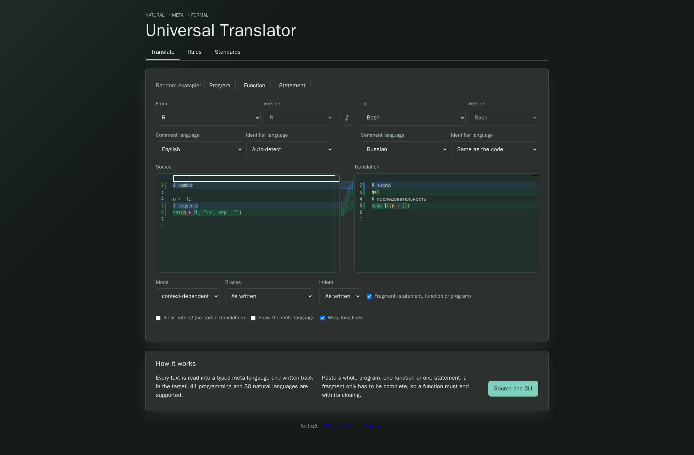
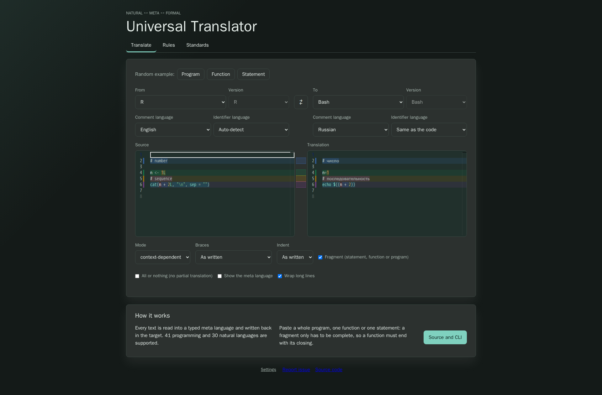

# Comment translation and concrete layout

Changing comment words used to change code layout through four paths. Natural
and machine sources missed the in-place translation path. Layout alignment
included comment words when choosing code anchors, so changing their spelling
could change the code matches even after comments were matched separately.
Partial translation reapplied layout to an already preserved source, changing
mixed LF/CRLF endings. Finally, machine comment scanning lacked native quote
and block-comment marks.

JavaScript and Rust now select code anchors independently of comments. Natural
notes use logical sentence boundaries, so a note-looking line inside quoted
multiline text remains literal. Machine comments use native markers, quoted
strings and nested WebAssembly comments. In-place replacement preserves markers,
indentation, trailing spaces, blank lines and line endings. Partial translation
still calculates mappings, without respacing an in-place comment replacement.
Unterminated machine block comments are rejected, including an unclosed outer
WebAssembly comment whose inner comment has closed.

## Reproduction and verification

Run the finite audit:

```sh
node --max-old-space-size=512 experiments/issue-16-comment-whitespace.mjs --before
node --max-old-space-size=512 experiments/issue-16-comment-whitespace.mjs
```

The `--before` mode loads translation/layout stages from `eeb793d`, retaining
their current dependencies. It avoids a checkout, dependency installation or
build. Across 111 imperative reader families and 551 same/cross-language cases,
the old stages fail 81 assertions: 79 same-language layout comparisons and two
comment-toggle comparisons (R to Python and Bash). The corrected stages pass
all 551 cases. Inputs contain paragraph gaps, leading/trailing blank lines and
CRLF; generated runtime headers retain their own concrete bytes. These finite
fixtures establish the named behavior, rather than complete grammar coverage.

Automated regressions are `js/tests/comment-whitespace.test.js`,
`rust/tests/comment_whitespace.rs`, and the R-to-Bash tests in both layout test
files. They check raw comment translation and partial translation through all
111 imperative families, an additional SQL query, multiline natural literals,
Unicode offsets, native machine quotes and nested/unterminated comments. The
focused checks pass: 66 JavaScript tests and 17 Rust tests, plus ESLint and
Clippy. Logs and audit JSON are archived in `logs/comment-whitespace-*`.

For browser reproduction, start the existing Vite development application,
generate MCP code with
`node experiments/issue-16-comment-whitespace-browser.mjs`, then pass that file
to Playwright MCP `browser_run_code_unsafe`. It serves only the previous two
stages for the before capture, restores the current stages for the after
capture, and asserts the actual translated text before each screenshot. In the
R-to-Bash example, the blank line after the first translated comment was lost
and is now retained. Source/target colour groups remain aligned. The browser
is closed after verification.

Before:



After:



Broader grammar-production review remains open under requirement 16.2. The
audit also exposed separate reader questions requiring their own regressions:
generated PHP/Rocq headers with altered leading whitespace/line endings, and
Perl print concatenation around an arithmetic expression. The finite audit
keeps valid generated headers intact and uses a simple variable print; it does
not count those unrelated failures as resolved.
