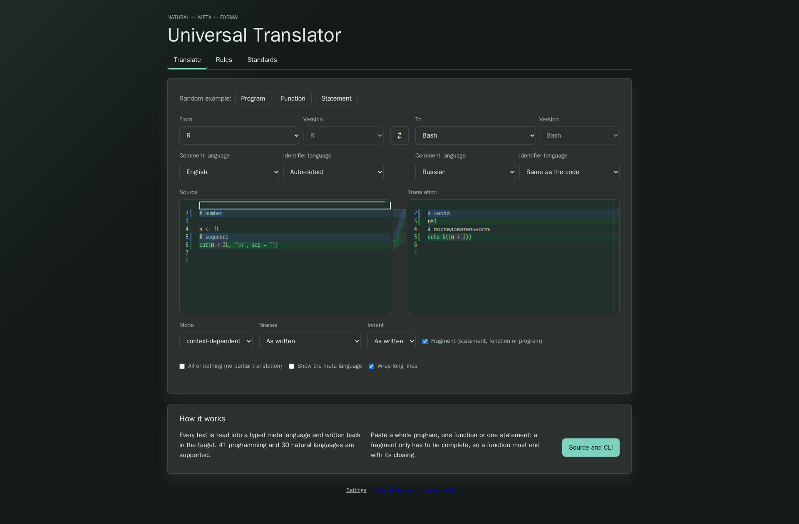
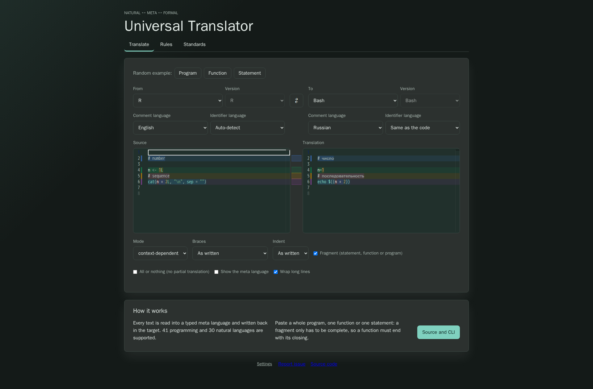
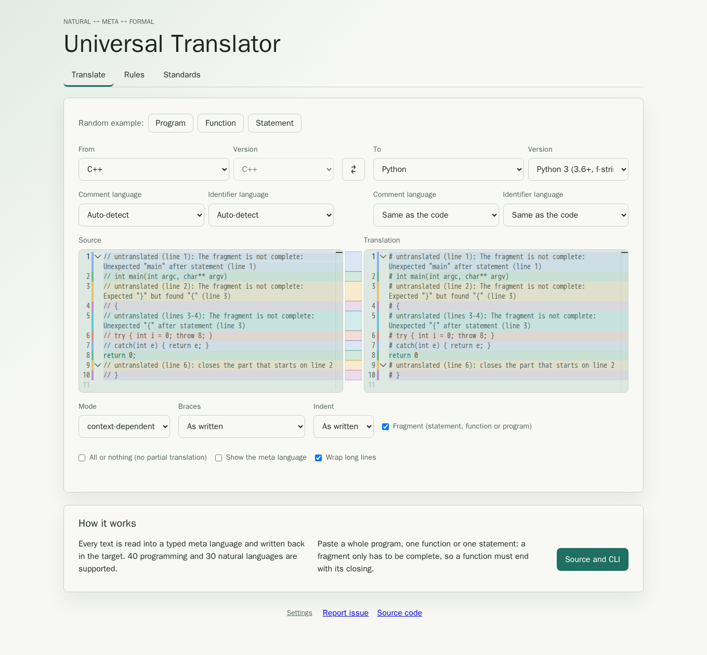
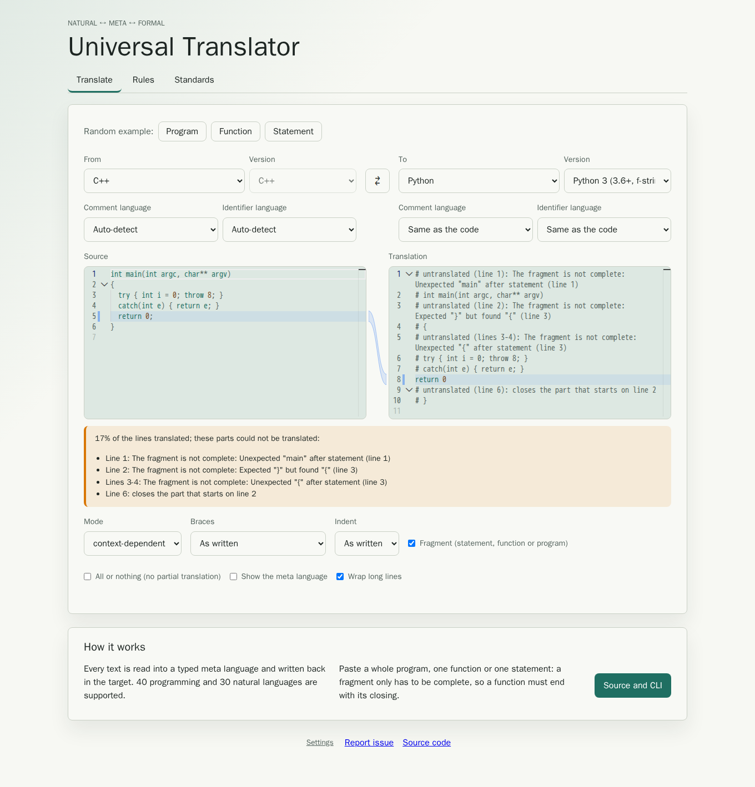
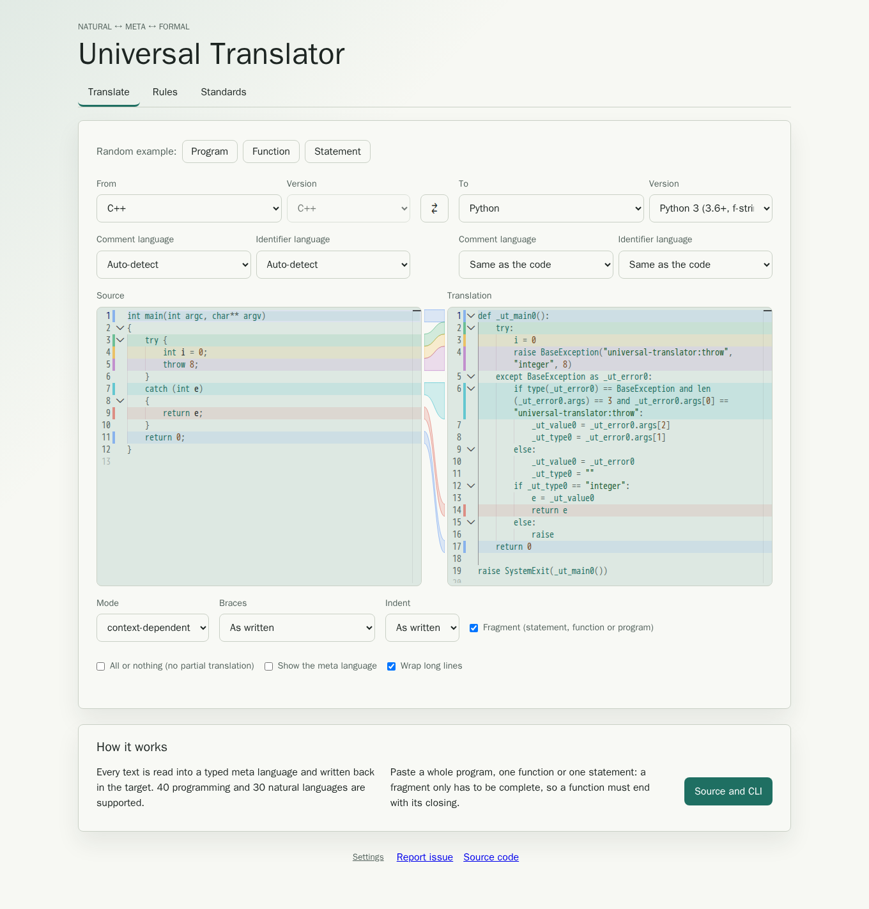
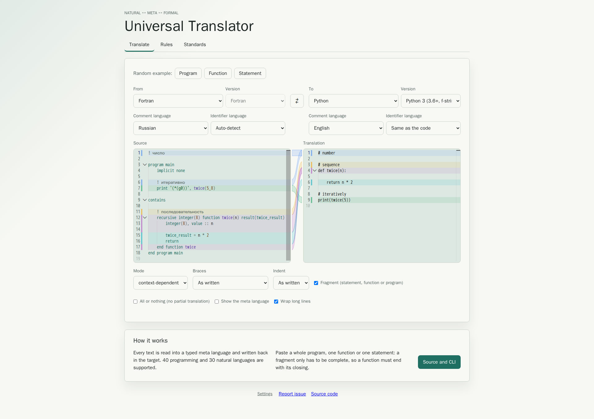

## Summary

Fixes #16
Fixes #1
Fixes #2
Fixes #10
Fixes #6
Fixes #8
Fixes #12
Fixes #14

This draft addresses translation correctness and the unfinished requirements inherited from earlier issues. **The full acceptance criteria are not yet met; keep this PR unmerged while implementation continues.**

Implemented and checked so far:

- Explicit meta fields distinguish conditions, bodies, expression statements, operands and arguments in JavaScript and Rust. Shared exact fixtures preserve annotated blocks and extension fields; a nested-program audit checks visible roles through all 111 current reader families.
- Correcting the source language preserves the original source. The footer has Source code and Report issue links; the report includes source, result, detected language, options, rules and errors.
- Comment-only translation keeps source bytes outside comments across all 111 imperative reader families and SQL, including natural notes, machine comments, mixed line endings and partial translation. Code alignment is independent of comment wording; a 551-case audit and complex literal regressions cover the repair. Multiline comment tokens contribute every covered line to the map.
- Powers inside interpolation retain the entire expression, with right association and grouping. Unread interpolation tokens raise an error. Power support across every target remains unfinished.
- JavaScript const array bindings with mutating calls become mutable Rust containers.
- An isolated ambiguous name such as `c` parses as English and ranks first on a tie.
- Russian boolean objects and comparison referents share grammatical-case rules; sequence and iteration vocabulary is available in all 30 natural languages.
- Java method/parameter annotations, nested generic types, and continued fluent calls survive translation. The Spring example translates to Python and its small framework doubles verify the 201 response.
- C++ typed throw/catch values retain their meaning in Python and JavaScript, including nested rethrows. The exact issue example compiles and exits with status 8 in all three runtimes.
- Default formal, natural and machine readers retain lossless concrete source records, with UTF-8 byte offsets and exact reconstruction in JavaScript and Rust. Partial parsing also preserves malformed input, trivia-only input and CRLF; accepted fragments and unread ranges are separate.
- Source ownership follows semantic nodes through parsing, rewrites, all seven machine instruction formats and lifting. The complete Java Fibonacci interpolation maps to both the Bash call and echo, and both map back to the Java print without colouring the loop. All 30 controlled natural languages map statements in both directions. Partial recovery combines maps across valid fragments, failure notes and custom prose that splits into several output lines.
- File, function and entry-point comment headers retain independent positions in every current reader/writer, even when translated words and header order change. Fortran-to-Python colour mapping has a browser regression and before/after screenshots.
- Partial coverage excludes parts rejected by the target writer and includes successfully translated prose. A wholly rejected program reports 0% and retains its detailed line errors. JavaScript and Rust regressions cover reader failures, writer failures, mixed success and blank lines.
- JavaScript and Rust grammar workspaces import and execute nine formats, preserve concrete syntax/provenance, update sources and dependencies, merge equivalent rules with stable identities, retain separate editions, apply six transform stages and install semantic readers into translation. The browser-safe `/grammar` entry, public types, bounded recovery and runnable example are verified.
- Four introspection question aspects keep their subject expressions through Python, JavaScript/TypeScript and every natural grammar. Runtime documentation is separate from comments; Python 3.12/3.13 editions, multiline contents, aliases, shadowing and native execution are covered.
- Selection queries compose scoped predicates and projections across SQL, C# LINQ, Python comprehensions, JavaScript/TypeScript filter/map chains and all 71 natural grammars. Collection types, nested binders, C# range-name rules and eager/deferred execution are covered. A native SQLite/Python/Node/C# example checks results and mutation between construction and enumeration. SQL value contracts now preserve nullable numeric rows, three-valued logic, IS tests and WHERE truth, with 81 native cases across SQLite/Python/Node/C#. Verified helpers retain concrete source and survive formal/natural rereading. Schema-dependent SQL values, broader clauses and other targets remain unfinished.
- Both engines read all 34 original Hello World Collection programs. The original Portable Object Compiler example now composes message sends, blocks, process arguments, unit updates and ordered Objpak string sets. A pinned original compiler agrees with generated Python, JavaScript, Rust and Objective-C for duplicates, Unicode, growth, aliases and live iteration; all 71 natural grammars round-trip its algorithm. Other set/library targets remain unfinished.
- Exact UTF-8 subline regions accompany line maps in both libraries and HTTP APIs. Editor selections map individual names and split constructs, with unit and real-browser checks.
- The case study archives all issue/PR discussions, eight attachments, 22 compressed solver logs, local/CI evidence, root-cause analysis and primary-source architecture research. The Rust package includes the new regression fixtures.

Still being implemented: broader mapping precision, the reported gutter artifact, agreement throughout all natural languages and comments, full operator coverage, remaining exception targets, complete SQL/LINQ and remaining question targets, complete upstream grammar production/semantic coverage and faithful feature lowering, and every inherited coverage gap. Passing CI for the completed pieces does not establish completion of those criteria.

## Reproduce and verify

- Source corruption: paste the C++ try/catch example from issue 16, then correct the source selector to C++. Before this change the source becomes error comments; afterward it stays byte-for-byte intact and translates to executable Python.
- `console.log(`${2 ** 10}`);` from JavaScript to Python must retain `2 ** 10`.
- Translate `// Привет`, a blank line, and `console.log( "Hello World!");` to Python with English comments: the blank line and the space before the string remain.
- Translate a const JavaScript array followed by `.push(3)` to Rust: its declaration uses `let mut`.

Automated checks include `js/tests/issue-16.test.js`, `annotations.test.js`, `exceptions.test.js`, `concrete-syntax.test.js`, `natural-wordings.test.js`, `issue-report.test.js`, `universal-app-editors.test.js`, the web end-to-end suite, `grammar-workspace.test.js`, and matching focused Rust targets. The grammar adapter has 13 JS/Deno tests and nine Rust tests; TypeScript and Deno check the public type example, the browser executes the adapter, and the production web build passes. Run `node examples/translation/verify-exceptions.mjs` for native C++/Python/JavaScript exit-status verification and `python3 examples/translation/spring/verify.py` for the Spring example. One Changeset prepares the next release.

The `a3cee36` CI run found an Objective-C condition regression in existing algorithms and a CodeQL finding in the new native verifier. Boolean conditions now retain their type after inference, `(void)` parameter markers parse correctly, and generated headers support POC and GNU runtimes. The verifier uses fixed executable choices. All five workflows at `eeb793d` pass; the CodeQL review thread is resolved with an evidence reply. Focused checks pass: 21 JavaScript Objpak/condition regressions, 18 Rust Objpak regressions, existing algorithm round trips, native POC/Python/Node/Rust/GNU comparisons, shared goldens, lint and Clippy. All five workflows at `08e200c` pass, including full library/native checks and web/desktop builds. The subsequent Rocq/PHP fixes have focused and native local verification and require their own current-head CI after pushing. The original collection source fails on `0a44abd` and passes with this draft; `node experiments/issue-16-objc-regression.mjs` reproduces both outcomes.

Query validation includes 121 focused JavaScript regressions, 26 Rust regressions, native SQLite/Python/Node/C# execution, Clippy, lint and natural-language golden checks. See the case studies [QUERIES.md](https://github.com/link-foundation/universal-translator/blob/issue-16-fb080613587e/docs/case-studies/issue-16/QUERIES.md) and [OBJPAK.md](https://github.com/link-foundation/universal-translator/blob/issue-16-fb080613587e/docs/case-studies/issue-16/OBJPAK.md) for architecture, reproduction and explicit remaining limits.

Meta notation: `js/tests/meta-roles.test.js` and `rust/tests/meta_notation.rs` verify four shared exact fixtures and all 111 current reader families. `node experiments/issue-16-meta-roles.mjs` demonstrates the previous lost annotated-block metadata and inconsistent child ordering. See [META-ROLES.md](https://github.com/link-foundation/universal-translator/blob/issue-16-fb080613587e/docs/case-studies/issue-16/META-ROLES.md) for evidence.

Objpak reproduction: translate the unchanged `examples/objpak/hello.m` from Objective-C. Previously the reader stopped at `[Set new]`; it now retains the argument, set and iteration semantics. Run `node examples/objpak/verify-native.mjs` to bootstrap the pinned historical compiler without system installation and compare successful exits and output against generated Python, JavaScript, Rust and Objective-C. `js/tests/objpak.test.js` and `rust/tests/objpak.rs` also cover helper provenance, lossless UTF-8 concrete ranges, shadowing, edition rejection and formal/natural round trips. The native comparison caught undefined C89 fallthrough from generated `main`; both writers now return success explicitly, with regenerated Objective-C goldens and a regression.

Reproduce the coverage repair by translating the issue's C++ exception example to C: the rejected output previously claimed 100%, and now reports 0% with the affected lines. `issue-8.test.js` and `issue_8.rs` use a controlled writer rejection so the regression remains valid as more exception targets are implemented.

Condition regression: `node experiments/issue-16-objc-conditions.mjs` reproduces the old boolean-call rewrite and asserts the corrected algorithm. `examples/objpak/conditions.m`, `js/tests/objc-conditions.test.js` and the Rust Objpak tests cover boolean and numeric calls, variable conditions, void parameter markers and concrete runtime headers. The native verifier executes the same generated program with POC and GNU-runtime Objective-C.

Query reproduction: translate `SELECT age + 1 FROM people AS person WHERE age >= 18 AND age < 65;` to Python, JavaScript, C# or a natural grammar. Run `node examples/queries/verify-native.mjs` for finite cross-runtime results, generated C# function compilation and eager/deferred mutation checks. `js/tests/queries.test.js` and `rust/tests/queries.rs` also check round trips, quoted SQL identifiers, strategy rejection, collection types and nested variable scopes.

Perl arithmetic reproduction: `print((2 + 3) * 4)` from Python previously generated Perl that printed `5` and lost the newline. Both writers now enclose the complete print argument. `node experiments/issue-16-perl-print.mjs --before` demonstrates the incorrect native output and changed semantic tree; the current path has exact expected output and no semantic difference. Matching JS/Rust regressions, shared program/fragment goldens, lint and Clippy pass. `node examples/printing/verify-native.mjs` compares eight prints across original Python, generated Perl and restored Python, and runs in native CI. See [PRINT-EXPRESSIONS.md](https://github.com/link-foundation/universal-translator/blob/issue-16-fb080613587e/docs/case-studies/issue-16/PRINT-EXPRESSIONS.md) for evidence and the primary manual.

Rocq header reproduction: add a leading blank line, CRLF or a comment to a generated Rocq program. The old exact-text header check parsed helper definitions as user code and failed; the readers now match the full token sequence while retaining comments, source offsets and correct line numbers. Changed helper values remain rejected. `node experiments/issue-16-runtime-headers.mjs --before` fails six checks; the current lexer passes all six. Matching JS/Rust regressions cover semantic identity, concrete reconstruction and partial translation. `node examples/runtime-headers/verify-native.mjs` compiles all six layouts and compares exact output with original and restored Python; it also runs in native CI. See [RUNTIME-HEADERS.md](https://github.com/link-foundation/universal-translator/blob/issue-16-fb080613587e/docs/case-studies/issue-16/RUNTIME-HEADERS.md).

PHP header reproduction: prepend CRLF before `<?php` or add output whitespace after `?>`. The readers now retain that whitespace as literal output and consume only PHP's first closing-tag newline. Native opening-tag separators distinguish real code from lookalikes such as `<?phpecho`. `node experiments/issue-16-php-output.mjs --before` fails seven of nine native cases; the current reader passes all nine. The existing native header example checks PHP/Python/PHP and direct PHP/PHP output bytes, with matching JS/Rust semantic, concrete and partial-translation tests. Focused checks pass (24 JS, 26 Rust), ESLint and Clippy. Mixed markup, repeated code sections, short echoes and shared conditional/loop scope now compose in both engines. Fifteen new finite native cases fail with the previous reader and pass with the corrected reader. Native round trips exposed PHP line comments containing `?>` closing code early; both writers now retain code mode with block comments. Matching JS/Rust regressions check semantic and concrete round trips, comment translation, token lines, tagless snippets and separate UTF-8 markup/code regions. The native example checks 24 PHP documents and a Python comment program. Complete PHP grammar coverage and explicit plaintext-document/snippet disambiguation remain open; evidence, limits and primary sources are in the runtime-header case study.

SQL negation reproduction: `SELECT age FROM people AS p WHERE NOT age = 18;`
previously negated the column before testing equality, selecting different
rows. Both readers now apply SQL precedence and both SQL writers preserve
negation grouping. Native checks also found ungrouped nested comparisons and
negated operands changing Python behavior; both Python writers now retain
those boundaries. `node experiments/issue-16-sql-negation.mjs --before` fails
16/23 cases with the old SQL reader; `--before-writer` independently fails four
with the old writer. The current path passes all 23, including native SQLite,
Python, Node and C# execution in the query example. Matching JS/Rust regressions,
number checks, lint and Clippy pass. The nullable numeric extension below
adds separate SQL value contracts. Evidence is in the query case study.

## Browser evidence

Comment translation, before: changing R comments to Russian loses the paragraph before the first Bash statement:

After: the same translation retains the paragraph and its colour mappings:

`node experiments/issue-16-comment-whitespace.mjs --before` fails 81 layout assertions with the previous translation/layout stages; the corrected stages pass all 551 cases. The matching JS/Rust regression targets, SQL and complex-comment coverage are documented in [COMMENT-WHITESPACE.md](https://github.com/link-foundation/universal-translator/blob/issue-16-fb080613587e/docs/case-studies/issue-16/COMMENT-WHITESPACE.md).

Nested-comment reproduction: `node experiments/issue-16-nested-comments.mjs --before` fails 29/34 checks with the previous lexer; the current path passes all 34. Nine formal languages now retain complete nested comment spans, and Rocq honours strings inside comments. Matching JavaScript/Rust regressions cover translation, concrete UTF-8 records, layout and unclosed input. Focused checks pass: 26 JavaScript tests, 21 Rust tests, ESLint, Clippy and the production chunk graph. Primary manuals and finite before/after evidence are linked from the same case study.

Before correcting the source language:

After correcting the source language; the footer also contains the reporting and source links:

The issue's C++ example translated to executable Python:

The Java print statement and its two Bash lines share a colour group:

Before: Fortran's iteration header shares the file header's colour; Python's iteration header has no matching colour:

After: each translated header shares its own colour in both panes:

Before: a target writer rejection still reports 100% translated:

After: the same rejected program reports 0% with the affected lines and reason:

Question reproduction: translate `type(meaning)`, `meaning.__doc__`, imported `inspect.getsource(meaning)` or `meaning??` from Python to a natural grammar. `js/tests/questions.test.js` and `rust/tests/questions.rs` cover these cases; the runnable source-file example is `examples/questions/meaning.py`. The focused JavaScript question/version/chunk checks (26 tests), Rust question/version checks (13 tests), and targeted Clippy checks pass. Python → JavaScript → Python execution retains the original runtime documentation. See the case study `QUESTIONS.md` for edition handling and archived primary research.

Nullable SQL reproduction: `SELECT age FROM people WHERE NOT age = 18;` must
exclude a NULL row; `SELECT NULL OR 1 FROM people;` returns numeric one and
`SELECT age / 0 FROM people;` returns NULL in the verified SQLite profile.
`node experiments/issue-16-sql-values.mjs --before` fails 65/81 finite cases at
`c739a05`; the current experiment passes all cases, including SQL restored from
JavaScript. Run `node examples/queries/verify-native.mjs` for all 81 cases in
SQLite, Python, Node and compiled C#. New JS/Rust SQL-value tests cover four host
grammars, all 71 natural grammars, exact UTF-8 helper productions, name collisions,
invalid caller contracts and significant JS/TS return newlines. Shared runtime
sources and the existing native CI job cover this subset. Broader SQL schemas,
type coercion, dialects and clauses remain open; see [the query case study](docs/case-studies/issue-16/QUERIES.md).

Integer-wrapper reproduction: C's `(7 + 5) / (1 + 3)` previously generated
`Math.trunc(7 + 5 / 1 + 3)` and printed 15 instead of 3. Both shared emitters
now retain operand grouping. `node experiments/issue-16-division-wrappers.mjs
--before` demonstrates incorrect output in five native configurations; the
current path passes. `node examples/arithmetic/verify-native.mjs` compiles C and
compares ten quotients with Node/ES5/TypeScript, Perl and PHP integer wrappers.
Matching JS/Rust regressions cover every wrapper grammar, including Lua 5.1 and
MATLAB; eight JS tests, ten Rust tests, lint and Clippy pass. See [the arithmetic case study](docs/case-studies/issue-16/ARITHMETIC.md).

Signed-integer reproduction: Python's `-7 // 3` and `-7 % 3` previously became
the C/JavaScript answers -2 and -1 instead of -3 and 2. Both engines now preserve
four distinct rounding/remainder contracts and use shared operator algorithms
only where a target lacks the required operation. `node
experiments/issue-16-integer-rounding.mjs` compares 168 native results; 46 failed
at `e49d979`, and all pass with this change. `node
examples/arithmetic/verify-rounding.mjs` compares independent original Python/C
outputs with 23 available generated configurations, and runs in the existing
native CI step. New JS/Rust tests cover compound updates, real slash behavior,
fresh names, changed/rebound/escaping helpers, every natural grammar and all seven
machine formats. Their LLVM round trips exposed an erroneous drop on dead stack
reloads, now fixed in both readers. Existing Python/Ruby/Perl algorithm goldens
now retain their source arithmetic contract. Observable JavaScript signed zero,
C operand evaluation order, numeric widths, overflow, zero divisors and broader
real arithmetic remain open and are documented in the case study.
