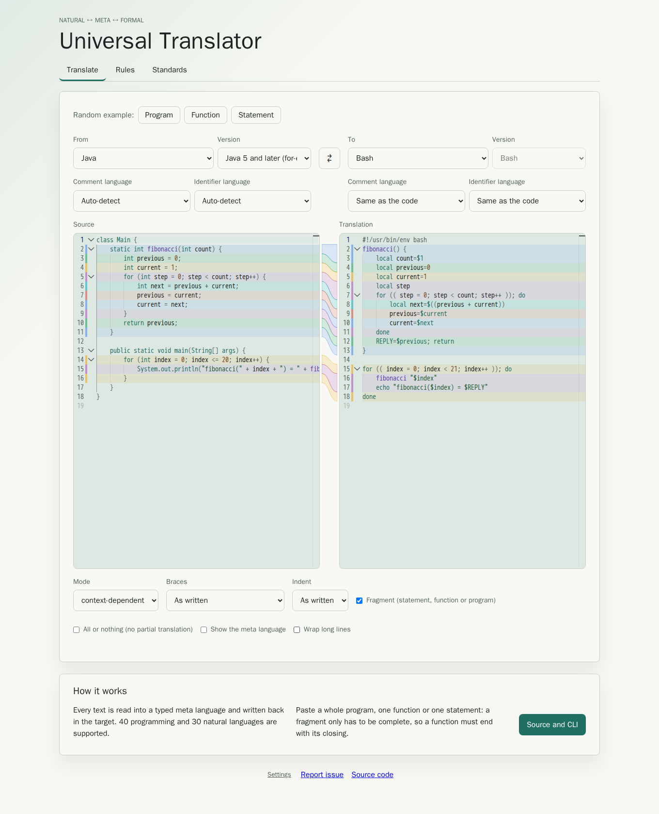
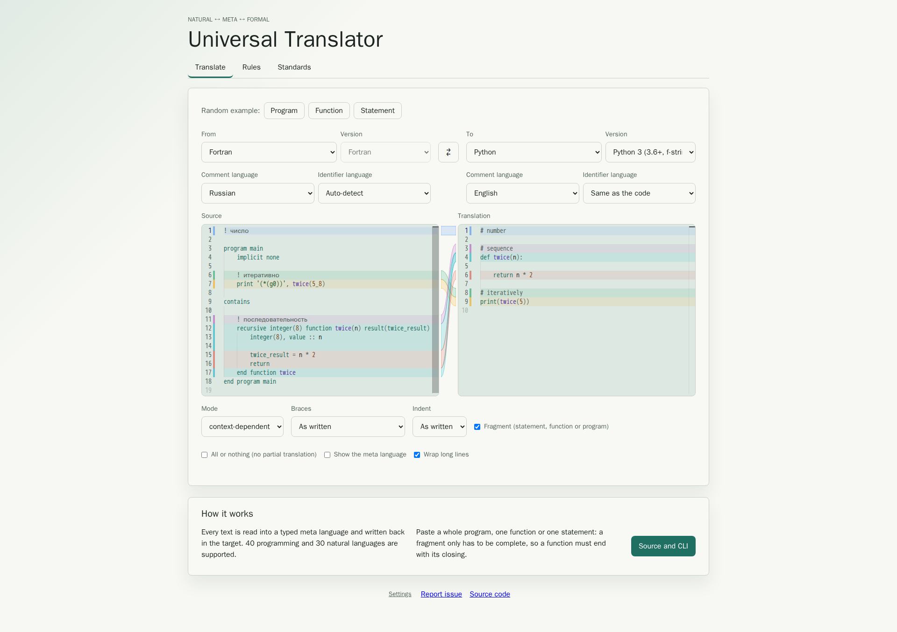
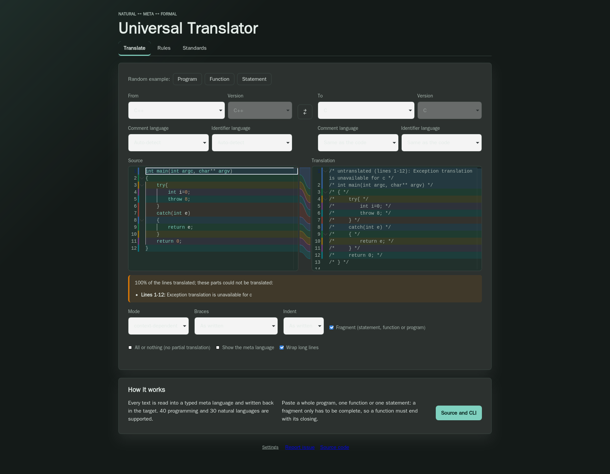
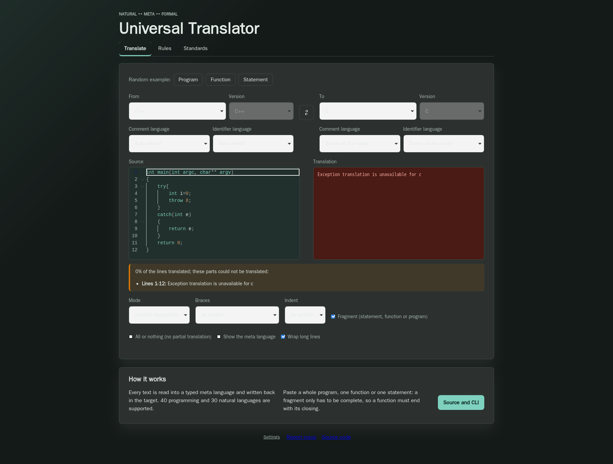

## Summary

Fixes #16
Fixes #1
Fixes #2
Fixes #10
Fixes #6
Fixes #8
Fixes #12
Fixes #14

This draft addresses translation correctness and the unfinished requirements inherited from earlier issues. **The full acceptance criteria are not yet met; keep this PR unmerged while implementation continues.**

Implemented and checked so far:

- Explicit meta fields distinguish conditions, bodies, expression statements, operands and arguments in JavaScript and Rust.
- Correcting the source language preserves the original source. The footer has Source code and Report issue links; the report includes source, result, detected language, options, rules and errors.
- Translated comments preserve the following blank line. Multiline comment tokens contribute every covered line to the map.
- Powers inside interpolation retain the entire expression, with right association and grouping. Unread interpolation tokens raise an error. Power support across every target remains unfinished.
- JavaScript const array bindings with mutating calls become mutable Rust containers.
- An isolated ambiguous name such as `c` parses as English and ranks first on a tie.
- Russian boolean objects and comparison referents share grammatical-case rules; sequence and iteration vocabulary is available in all 30 natural languages.
- Java method/parameter annotations, nested generic types, and continued fluent calls survive translation. The Spring example translates to Python and its small framework doubles verify the 201 response.
- C++ typed throw/catch values retain their meaning in Python and JavaScript, including nested rethrows. The exact issue example compiles and exits with status 8 in all three runtimes.
- Default formal, natural and machine readers retain lossless concrete source records, with UTF-8 byte offsets and exact reconstruction in JavaScript and Rust. Partial parsing also preserves malformed input, trivia-only input and CRLF; accepted fragments and unread ranges are separate.
- Source ownership follows semantic nodes through parsing, rewrites, all seven machine instruction formats and lifting. The complete Java Fibonacci interpolation maps to both the Bash call and echo, and both map back to the Java print without colouring the loop. All 30 controlled natural languages map statements in both directions. Partial recovery combines maps across valid fragments, failure notes and custom prose that splits into several output lines.
- File, function and entry-point comment headers retain independent positions in every current reader/writer, even when translated words and header order change. Fortran-to-Python colour mapping has a browser regression and before/after screenshots.
- Partial coverage excludes parts rejected by the target writer and includes successfully translated prose. A wholly rejected program reports 0% and retains its detailed line errors. JavaScript and Rust regressions cover reader failures, writer failures, mixed success and blank lines.
- JavaScript and Rust grammar workspaces import and execute nine formats, preserve concrete syntax/provenance, update sources and dependencies, merge equivalent rules with stable identities, retain separate editions, apply six transform stages and install semantic readers into translation. The browser-safe `/grammar` entry, public types, bounded recovery and runnable example are verified.
- Four introspection question aspects keep their subject expressions through Python, JavaScript/TypeScript and every natural grammar. Runtime documentation is separate from comments; Python 3.12/3.13 editions, multiline contents, aliases, shadowing and native execution are covered. SQL/LINQ and remaining targets are still in progress.
- Exact UTF-8 subline regions accompany line maps in both libraries and HTTP APIs. Editor selections map individual names and split constructs, with unit and real-browser checks.
- The case study archives all issue/PR discussions, eight attachments, 22 compressed solver logs, local/CI evidence, root-cause analysis and primary-source architecture research. The Rust package includes the new regression fixtures.

Still being implemented: broader mapping precision, the reported gutter artifact, agreement throughout all natural languages and comments, full operator coverage, remaining exception targets, SQL/LINQ and remaining question targets, complete upstream grammar production/semantic coverage and faithful feature lowering, and every inherited coverage gap. Passing CI for the completed pieces does not establish completion of those criteria.

## Reproduce and verify

- Source corruption: paste the C++ try/catch example from issue 16, then correct the source selector to C++. Before this change the source becomes error comments; afterward it stays byte-for-byte intact and translates to executable Python.
- `console.log(`${2 ** 10}`);` from JavaScript to Python must retain `2 ** 10`.
- Translate `// Привет`, a blank line, and `console.log( "Hello World!");` to Python with English comments: the blank line and the space before the string remain.
- Translate a const JavaScript array followed by `.push(3)` to Rust: its declaration uses `let mut`.

Automated checks include `js/tests/issue-16.test.js`, `annotations.test.js`, `exceptions.test.js`, `concrete-syntax.test.js`, `natural-wordings.test.js`, `issue-report.test.js`, `universal-app-editors.test.js`, the web end-to-end suite, `grammar-workspace.test.js`, and matching focused Rust targets. The grammar adapter has 13 JS/Deno tests and nine Rust tests; TypeScript and Deno check the public type example, the browser executes the adapter, and the production web build passes. Run `node examples/translation/verify-exceptions.mjs` for native C++/Python/JavaScript exit-status verification and `python3 examples/translation/spring/verify.py` for the Spring example. One Changeset prepares the next release.

At `ac07029`, Rust, lint, native translation and the example app pass. Node, Bun and Deno failed a stale package-file assertion, repaired by `41570a3`. Docker omitted the grammar runtime, repaired by `69638cf`; an installed npm artifact test now executes an EBNF grammar through the public `/grammar` entry. That test passes locally. Header mapping adds three JS/Deno and three Rust regressions; 110 focused JS checks and 24 Rust mapping/concrete/layout checks pass, alongside lint, format, Clippy and real-browser colour checks. Current-commit CI follows this push. Earlier server, trace, archive-formatting and circular-web-chunk failures have focused repairs and preserved logs in the case study.

All required CI checks at `283f16a` pass, including Node, Bun, Deno, Rust, native toolchains, Docker and the web end-to-end suite. The later coverage repair has 41 passing focused JS checks and three selected Rust checks; its two new JS regressions fail before the repair. Reproduce it by translating the issue's C++ exception example to C: the rejected output previously claimed 100%, and now reports 0% with the affected lines. `issue-8.test.js` and `issue_8.rs` use a controlled writer rejection so the regression remains valid as more exception targets are implemented.

## Browser evidence

Before correcting the source language:

After correcting the source language; the footer also contains the reporting and source links:

The issue's C++ example translated to executable Python:

The Java print statement and its two Bash lines share a colour group:

Before: Fortran's iteration header shares the file header's colour; Python's iteration header has no matching colour:

After: each translated header shares its own colour in both panes:

Before: a target writer rejection still reports 100% translated:

After: the same rejected program reports 0% with the affected lines and reason:

Question reproduction: translate `type(meaning)`, `meaning.__doc__`, imported `inspect.getsource(meaning)` or `meaning??` from Python to a natural grammar. `js/tests/questions.test.js` and `rust/tests/questions.rs` cover these cases; the runnable source-file example is `examples/questions/meaning.py`. The focused JavaScript question/version/chunk checks (26 tests), Rust question/version checks (13 tests), and targeted Clippy checks pass. Python → JavaScript → Python execution retains the original runtime documentation. See the case study `QUESTIONS.md` for edition handling and archived primary research.
