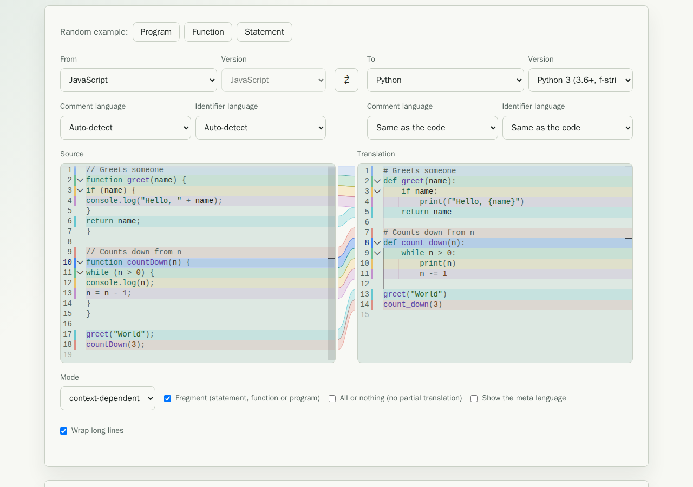
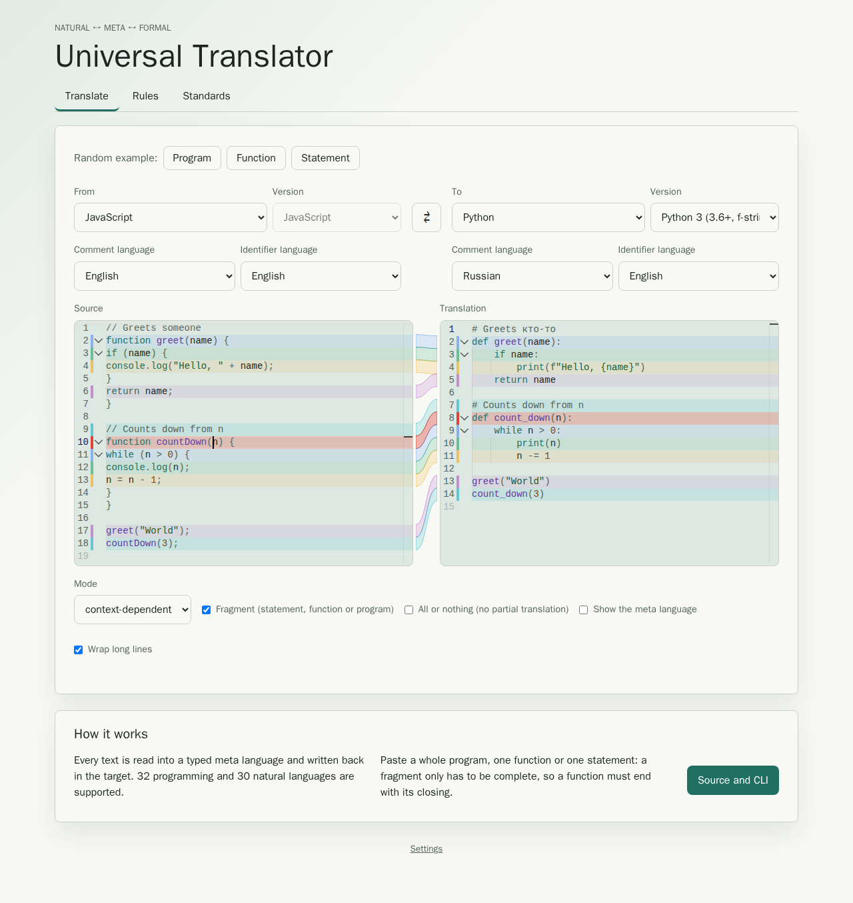
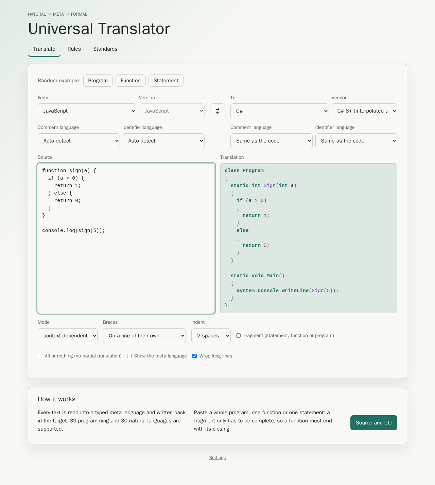

# 15: CST by default, linked Monaco editors, comment translation, nested grammars, machine dialects and language versions

## Summary

Fixes #14

This PR addresses issue 14 and the requirements of earlier issues and pull requests that had not been delivered. Every change is made in both JavaScript and Rust, and the two command lines print byte-identical output. The full case study is in [`docs/case-studies/issue-14/`](https://github.com/link-foundation/universal-translator/tree/issue-14-213b02ae6953/docs/case-studies/issue-14):

- `README.md`: timeline, the issue's requirements R1–R24, root causes and alternatives;
- `previous-requirements.md`: every earlier requirement with its status;
- `prior-art.md` and `architecture.md`;
- `requirements.lino`: CI fails while any requirement is neither done nor reported as blocked with a reason.

### Issue 14 requirements

- **A concrete syntax tree (CST) by default.** Whitespace and blank lines now survive a translation. The layout pass (`js/src/translation/layout.js`, `rust/src/layout.rs`) aligns the tokens of the output with those of the source and returns a `lineMap`. `--layout target` restores the emitter's own formatting.
  - `main`: `console.log( "Hello World!");` → `console.log("Hello World!");`
  - this branch: `console.log( "Hello World!");` → `console.log( "Hello World!");`
- **Monaco by default, with linked editors.**
  - Folding regions now work for every language.
  - Folding, selection, the cursor and scrolling are shared by both editors. Scrolling is mapped block by block, so blocks of different sizes stay aligned.
  - Lines that map to each other get matching colours, as in Compiler Explorer.
- **Comment and identifier language selectors on both sides.** The option checkboxes are now below the editors.
- **Comments are translated.** A shared multilingual vocabulary (`data/natural/vocabulary.lino`) is used both to detect a comment's language and to translate it.
  - `// Привет мир` → `// Hello world`.
  - «Привет» is now detected as Russian.
  - «Как хорошо покакать?» translates to "How good to poop?" (free prose translation).
- **Deeper grammars.**
  - Prose reads as `Prose > Sentence > Word`, with concepts and parts of speech.
  - Comments and strings are read with their own grammars (code in prose, prose in code). Long texts are stored once and referred to by id. Use `--shallow` for the plain tree.
- **A more general meta language.** `print` is a call to the library function `print-line`.
- **Assembly and intermediate languages.** NASM, GNU as, ARM64, LLVM IR, WebAssembly text, CIL and JVM bytecode are written and read back.
- **Language versions.** `javascript@es5`, `php@5`, `csharp@5`, `python@2`, `python@3.5`, `lua@5.1`, `java@1.4`, `swift@1` and `scala@2.9` are available. `registerLanguageVersion` adds a version of your own.
- **More tasks and corpora.**
  - 22 Rosetta Code tasks go through all 33 programming languages and the 7 machine targets.
  - 33 of the 34 programs of the Hello World Collection are read.
  - `check-equivalence` checks that a translation does what its source does.
- **Debugging and research.**
  - `--trace` prints the tree after every stage, and the web app logs translations and editor-sync events with `?debug`.
  - formal-ai was tried on six tasks; its failures are reported as link-assistant/formal-ai#1641 and link-assistant/formal-ai#1642.

### Screenshots

Line mapping in the linked Monaco editors:



Comment and identifier language selectors on both sides:





### Tests

- JavaScript: `npm test` passes 1823 tests, with 1 skipped (shellcheck is not on the PATH locally).
  - Tests touched by this PR include `layout`, `comments`, `prose`, `nesting`, `language-versions`, `machine-dialects`, `hello-world-dialects`, `identifiers` and `ranking`. The web app has unit tests and end-to-end tests.
  - `npm run lint` and `node scripts/check-requirements.mjs` pass.
- Rust: every JavaScript test above has a twin under `rust/tests/` (for example `layout.rs`, `prose.rs`, `nesting.rs`, `language_versions.rs` and `hello_world_dialects.rs`).
  - `cargo clippy --all-targets -D warnings` and `cargo fmt` pass.
  - The full `cargo test` runs in CI.

### Still open or blocked

These items are tracked in `docs/case-studies/issue-14/previous-requirements.md` ("Concise list: everything still open"). None of them is claimed as done.

1. **Blocked:**
   - The Objective-C program of the Hello World Collection is Portable Object Compiler code that clang rejects.
   - Publishing the unscoped npm name `universal-translator` needs the owner's npm account. `npm view universal-translator version` gives `E404`.
   - The JavaScript CLI loads Meta Language from an environment variable until link-foundation/meta-language#230 is released.
   - The upstream process fix link-assistant/hive-mind#3929 is still open.
   - `Example app` on `main` needs `RELEASE_PR_TOKEN`; it passes on this PR.
2. **Partial:**
   - Rosetta Code: 22 tasks, not the whole set. Strings, higher-order functions, data structures, input/output, objects and concurrency are not covered.
   - Language versions: 8 of the 33 programming languages have versions (Python, JavaScript, PHP, C#, Lua, Java, Swift and Scala), and British English is the only natural variant.
   - TIOBE top 50: 22 languages are missing.
   - Classes of objects are not read.
   - Sentences have no phrase or clause structure.
   - There is no binary reader.
   - Library code is not translated.
   - Ranking frequencies are Zipf priors, not counted from a corpus.


## https://github.com/link-foundation/universal-translator/pull/15#issuecomment-7180834287 by konard

## 🚨 Solution Draft Failed
The automated solution draft encountered an error:
```
CLAUDE execution failed with } ReadableStream { locked: false, state: 'readable', supportsBYOB: false }
```

### 🤖 **Models used:**
- Tool: Anthropic Claude Code
- Requested: `opus` (`claude-opus-5-5`)
- Thinking level: high (~23999 tokens)
- **Main model: Claude Opus 5.5** (`claude-opus-5-5`)
- **Additional models:**
  *  **Claude Sonnet 5.5** (`claude-sonnet-5-5`)

### 📎 **Failure log uploaded as Repository** (54903KB)
- [View complete failure log](https://raw.githubusercontent.com/konard/public-logs/main/tmp-hive-mind-log-upload-G9Z9lS/23d034f420f2d733/sanitized.log.txt)

---
*Now working session is ended, feel free to review and add any feedback on the solution draft.*

## https://github.com/link-foundation/universal-translator/pull/15#issuecomment-7180840760 by konard

<!-- hive-mind:recovery-lifecycle -->
✅ Recovery attempt completed successfully (attempt 2)
Updated: 2026-11-26T07:34:04.544Z
Attempt started: 2026-11-26T02:34:57.793Z
Recovery session: f6cae9c8-e210-4aca-948e-30c3d13e0cce
Previous session: c55d59eb-48e3-47df-83df-e74e25739cdc
Execution / log: 4f67937a-fa67-4b0a-90c4-c7a2029891a0
This attempt exited with code 0.

## https://github.com/link-foundation/universal-translator/pull/15#issuecomment-7180871629 by konard

🤖 **AI Work Session Started**

Started at 2026-11-26T02:30:41.709Z. Please wait for it to finish before giving feedback.

_Runtime: solve `v2.39.10` · tool `claude` · model `opus` · task image `konard/hive-mind-dind:2.39.10@sha256:3be89e0510e606204a332e64547ebcfb4c8e527476abbbbbcdc7dac124476a86`_

## https://github.com/link-foundation/universal-translator/pull/15#issuecomment-7180947461 by konard

## 📎 Intermediate working-session log (killed session)
This log file contains the complete execution trace of the AI solution draft process.

### 📎 **Log file uploaded as Repository** (36024KB)
- [View complete solution draft log](https://raw.githubusercontent.com/konard/public-logs/main/tmp-hive-mind-log-upload-ublQEX/bf1a3198478f6a82/sanitized.log.txt)

---
*Now working session is ended, feel free to review and add any feedback on the solution draft.*

## https://github.com/link-foundation/universal-translator/pull/15#issuecomment-7180947893 by konard

<!-- hive-mind:session-kill-notice -->
## ⚠️ Work session restarted after a failed run with a container OOM event

container OOM event — a process in the task cgroup was killed earlier; the session-end memory reading was 6.1 GB of 11.7 GB RAM available (47.4% used) at 2026-11-26T02:28:18.953Z

- **Exit code:** 1
- **OOM event observed at:** 2026-11-26T01:32:02.706Z
- **Working session:** `e695068f-a549-416d-a0a2-91d17c9b158c`
- **On-kill policy:** `resume` (`--on-session-kill=resume`)

<details><summary>Kill diagnostics</summary>

- last session memory reading — 6.1 GB of 11.7 GB RAM available (47.4% used) at 2026-11-26T02:28:18.953Z (phase `solve_exit`)
- last session V8 heap reading — 52 MB used of 1.6 GB limit (3.3%) at 2026-11-26T02:28:18.953Z (phase `solve_exit`)
- last session disk /: 57.7 GB free of 192.7 GB (70.1% used) at 2026-11-26T02:28:18.953Z (phase `solve_exit`)
- lowest host disk /tmp/start-command/logs/isolation/docker: 35.7 GB free of 192.7 GB (81.5% used) at 2026-11-26T02:02:33.748Z observed by the monitor while the session ran
- last session container cgroup reading — 620 MB used, 2.9 GB limit, peak 2.9 GB, 17 process(es) killed by the OOM killer, memory.events oom=53 at 2026-11-26T02:28:18.953Z (phase `solve_exit`)
- start-command watcher container cgroup reading — 2.9 GB limit, peak 2.9 GB, 17 process(es) killed by the OOM killer, memory.events oom=53
- container reports `State.OOMKilled = true` (an OOM event hit the container cgroup)
- host memory now — 6.3 GB of 11.7 GB RAM available (46.1% used)
- `/proc/pressure/memory`: some avg10=0.00 avg60=0.02 avg300=0.46 total=9225525667

</details>

🔄 A **new working session was started** to recover from this event (attempt 1/3). The launch was accepted; activity and the final outcome are not yet confirmed. Its working session is `c55d59eb-48e3-47df-83df-e74e25739cdc`.

📎 The intermediate working-session log was uploaded as a separate comment.

<sub>Reported by Hive Mind</sub>

## https://github.com/link-foundation/universal-translator/pull/15#issuecomment-7180958496 by konard

🤖 **AI Work Session Started**

Started at 2026-11-26T02:36:28.330Z. Please wait for it to finish before giving feedback.

_Runtime: solve `v2.39.10` · tool `claude` · model `opus` · task image `konard/hive-mind-dind:2.39.10@sha256:3be89e0510e606204a332e64547ebcfb4c8e527476abbbbbcdc7dac124476a86`_

## https://github.com/link-foundation/universal-translator/pull/15#issuecomment-7181033293 by konard

## 📎 Intermediate working-session log (killed session)
This log file contains the complete execution trace of the AI solution draft process.

### 📎 **Log file uploaded as Repository** (38299KB)
- [View complete solution draft log](https://raw.githubusercontent.com/konard/public-logs/main/tmp-hive-mind-log-upload-aqgk1h/8cefabc92437c940/sanitized.log.txt)

---
*Now working session is ended, feel free to review and add any feedback on the solution draft.*

## https://github.com/link-foundation/universal-translator/pull/15#issuecomment-7181033692 by konard

<!-- hive-mind:session-kill-notice -->
## ⚠️ Working session restarted after a kill — outcome pending

unknown — no resource marker, cgroup counter or kernel OOM report was available

- **Exit code:** 1
- **Working session:** `c55d59eb-48e3-47df-83df-e74e25739cdc`
- **On-kill policy:** `resume` (`--on-session-kill=resume`)

<details><summary>Kill diagnostics</summary>

- last session memory reading — 7.2 GB of 11.7 GB RAM available (38.1% used) at 2026-11-26T02:30:40.699Z (phase `after_clone`)
- last session V8 heap reading — 42 MB used of 1.6 GB limit (2.6%) at 2026-11-26T02:30:40.699Z (phase `after_clone`)
- last session disk /: 57.7 GB free of 192.7 GB (70.1% used) at 2026-11-26T02:30:40.699Z (phase `after_clone`)
- lowest host disk /tmp/start-command/logs/isolation/docker: 35.7 GB free of 192.7 GB (81.5% used) at 2026-11-26T02:02:33.748Z observed by the monitor while the session ran
- last session container cgroup reading — 476 MB used, 2.9 GB limit, peak 617 MB, 0 process(es) killed by the OOM killer, memory.events oom=0 at 2026-11-26T02:30:40.699Z (phase `after_clone`)
- host memory now — 6.8 GB of 11.7 GB RAM available (42.2% used)
- `/proc/pressure/memory`: some avg10=4.89 avg60=3.34 avg300=1.28 total=9230549282

</details>

🔄 A **new working session was started** to recover from this event (attempt 2/3). The launch was accepted; activity and the final outcome are not yet confirmed. Its working session is `f6cae9c8-e210-4aca-948e-30c3d13e0cce`.

📎 The intermediate working-session log was uploaded as a separate comment.

To continue manually:

```bash
solve https://github.com/link-foundation/universal-translator/issues/14 --think high --auto-merge --tool claude --attach-logs --verbose --no-tool-check --disable-report-issue --language en --resume 1ab3d6f4-f83a-40dc-8224-537ee3b40c7b
```

<sub>Reported by Hive Mind</sub>

## https://github.com/link-foundation/universal-translator/pull/15#issuecomment-7184591556 by konard

## 🚨 Solution Draft Failed
The automated solution draft encountered an error:
```
CLAUDE execution failed with } ReadableStream { locked: false, state: 'readable', supportsBYOB: false }
```

### 🤖 **Models used:**
- Tool: Anthropic Claude Code
- Requested: `opus` (`claude-opus-5-5`)
- Thinking level: high (~23999 tokens)
- **Main model: Claude Opus 5.5** (`claude-opus-5-5`)
- **Additional models:**
  *  **Claude Sonnet 5.5** (`claude-sonnet-5-5`)

### 📎 **Failure log uploaded as Repository** (117406KB)
- [View complete failure log](https://github.com/konard/public-logs/raw/main/tmp-hive-mind-log-upload-edgIfI/1688944489dcd236/sanitized.part-00.log.txt)

---
*Now working session is ended, feel free to review and add any feedback on the solution draft.*

## https://github.com/link-foundation/universal-translator/pull/15#issuecomment-7185527141 by konard

## 🤖 Solution Draft Log
This log file contains the complete execution trace of the AI solution draft process.

### 💰 **Cost estimation:**
- Calculated by Anthropic: $49.430599

### 🤖 **Models used:**
- Tool: Anthropic Claude Code
- Requested: `opus` (`claude-opus-5-5`)
- Thinking level: high (~23999 tokens)
- **Model: Claude Opus 5.5** (`claude-opus-5-5`)

### 📎 **Log file uploaded as Repository** (35556KB)
- [View complete solution draft log](https://raw.githubusercontent.com/konard/public-logs/main/tmp-hive-mind-log-upload-GGR0Gx/eec808ff38d0419c/sanitized.log.txt)

---
*Now working session is ended, feel free to review and add any feedback on the solution draft.*

## https://github.com/link-foundation/universal-translator/pull/15#issuecomment-7185588894 by konard

## ⚠️ Auto-merge blocked: this pull request is ready, but it was not merged automatically

All merge requirements are satisfied — CI passed, there are no conflicts, and there are no pending changes.

Auto-merge (`--auto-merge`) was requested but is being held back:

- **Required issue links have not been verified for this pull request.** (`issue_link_verification_failed`)
  - Command failed: gh api graphql -f query=query($owner:String!,$repo:String!,$number:Int!) { repository(owner:$owner,name:$repo) { issue(number:$number) { parent { number repository { nameWithOwner } parent { number repository { nameWithOwner } parent { number repository { nameWithOwner } parent { number repository { nameWithOwner } parent { number repository { nameWithOwner } parent { number repository { nameWithOwner } parent { number repository { nameWithOwner } parent { number repository { nameWithOwner }  } } } } } } } } } } } -f owner=link-assistant -f repo=hive-mind -F number=3929
gh: Could not resolve to an Issue with the number of 3929.

  - ➡️ Add a positive closing reference (for example "Fixes #123") to the pull request description for every required issue, then re-run the command.

**What to do next:**
- Add the missing closing references listed above to the pull request description and re-run the command so auto-merge can complete.
- Or merge this pull request manually — the issues listed above will then stay open.

---
*Reported automatically by hive-mind with the --auto-merge flag.*

## Pull request description

## Summary

Fixes #14

This PR addresses issue 14 and the requirements of earlier issues and pull requests that had not been delivered. Every change is made in both JavaScript and Rust, and the two command lines print byte-identical output. The full case study is in [`docs/case-studies/issue-14/`](https://github.com/link-foundation/universal-translator/tree/issue-14-213b02ae6953/docs/case-studies/issue-14):

- `README.md`: timeline, the issue's requirements R1–R24, root causes and alternatives;
- `previous-requirements.md`: every earlier requirement with its status;
- `prior-art.md` and `architecture.md`;
- `requirements.lino`: CI fails while any requirement is neither done nor reported as blocked with a reason.

### Issue 14 requirements

- **A concrete syntax tree (CST) by default.** Whitespace and blank lines now survive a translation. The layout pass (`js/src/translation/layout.js`, `rust/src/layout.rs`) aligns the tokens of the output with those of the source and returns a `lineMap`. `--layout target` restores the emitter's own formatting.
  - `main`: `console.log( "Hello World!");` → `console.log("Hello World!");`
  - this branch: `console.log( "Hello World!");` → `console.log( "Hello World!");`
- **Monaco by default, with linked editors.**
  - Folding regions now work for every language.
  - Folding, selection, the cursor and scrolling are shared by both editors. Scrolling is mapped block by block, so blocks of different sizes stay aligned.
  - Lines that map to each other get matching colours, as in Compiler Explorer.
- **Comment and identifier language selectors on both sides.** The option checkboxes are now below the editors.
- **Comments are translated.** A shared multilingual vocabulary (`data/natural/vocabulary.lino`) is used both to detect a comment's language and to translate it.
  - `// Привет мир` → `// Hello world`.
  - «Привет» is now detected as Russian.
  - «Как хорошо покакать?» translates to "How good to poop?" (free prose translation).
- **Deeper grammars.**
  - Prose reads as `Prose > Sentence > Word`, with concepts and parts of speech.
  - Comments and strings are read with their own grammars (code in prose, prose in code). Long texts are stored once and referred to by id. Use `--shallow` for the plain tree.
- **A more general meta language.** `print` is a call to the library function `print-line`.
- **Assembly and intermediate languages.** NASM, GNU as, ARM64, LLVM IR, WebAssembly text, CIL and JVM bytecode are written and read back.
- **Language versions.** `javascript@es5`, `php@5`, `csharp@5`, `python@2`, `python@3.5`, `lua@5.1`, `java@1.4`, `swift@1` and `scala@2.9` are available. `registerLanguageVersion` adds a version of your own.
- **More tasks and corpora.**
  - 22 Rosetta Code tasks go through all 33 programming languages and the 7 machine targets.
  - 33 of the 34 programs of the Hello World Collection are read.
  - `check-equivalence` checks that a translation does what its source does.
- **Debugging and research.**
  - `--trace` prints the tree after every stage, and the web app logs translations and editor-sync events with `?debug`.
  - formal-ai was tried on six tasks; its failures are reported as link-assistant/formal-ai#1641 and link-assistant/formal-ai#1642.

### Screenshots

Line mapping in the linked Monaco editors:


Comment and identifier language selectors on both sides:


### Tests

- JavaScript: `npm test` passes 1823 tests, with 1 skipped (shellcheck is not on the PATH locally).
  - Tests touched by this PR include `layout`, `comments`, `prose`, `nesting`, `language-versions`, `machine-dialects`, `hello-world-dialects`, `identifiers` and `ranking`. The web app has unit tests and end-to-end tests.
  - `npm run lint` and `node scripts/check-requirements.mjs` pass.
- Rust: every JavaScript test above has a twin under `rust/tests/` (for example `layout.rs`, `prose.rs`, `nesting.rs`, `language_versions.rs` and `hello_world_dialects.rs`).
  - `cargo clippy --all-targets -D warnings` and `cargo fmt` pass.
  - The full `cargo test` runs in CI.

### Still open or blocked

These items are tracked in `docs/case-studies/issue-14/previous-requirements.md` ("Concise list: everything still open"). None of them is claimed as done.

1. **Blocked:**
   - The Objective-C program of the Hello World Collection is Portable Object Compiler code that clang rejects.
   - Publishing the unscoped npm name `universal-translator` needs the owner's npm account. `npm view universal-translator version` gives `E404`.
   - The JavaScript CLI loads Meta Language from an environment variable until link-foundation/meta-language#230 is released.
   - The upstream process fix link-assistant/hive-mind#3929 is still open.
   - `Example app` on `main` needs `RELEASE_PR_TOKEN`; it passes on this PR.
2. **Partial:**
   - Rosetta Code: 22 tasks, not the whole set. Strings, higher-order functions, data structures, input/output, objects and concurrency are not covered.
   - Language versions: 8 of the 33 programming languages have versions (Python, JavaScript, PHP, C#, Lua, Java, Swift and Scala), and British English is the only natural variant.
   - TIOBE top 50: 22 languages are missing.
   - Classes of objects are not read.
   - Sentences have no phrase or clause structure.
   - There is no binary reader.
   - Library code is not translated.
   - Ranking frequencies are Zipf priors, not counted from a corpus.


## https://github.com/link-foundation/universal-translator/pull/15#discussion_r4702585736 by github-advanced-security[bot]

## CodeQL / Replacement of a substring with itself

This replaces 'числа.length' with itself.

[Show more details](https://github.com/link-foundation/universal-translator/security/code-scanning/7)

## https://github.com/link-foundation/universal-translator/pull/15#discussion_r4703314911 by github-advanced-security[bot]

## CodeQL / Polynomial regular expression used on uncontrolled data

This [regular expression](1) that depends on [library input](2) may run slow on strings starting with '@text.0 =  c"' and with many repetitions of ' c"a'.

[Show more details](https://github.com/link-foundation/universal-translator/security/code-scanning/8)

## https://github.com/link-foundation/universal-translator/pull/15#discussion_r4703793996 by github-advanced-security[bot]

## CodeQL / Incomplete multi-character sanitization

This string may still contain [<script](1), which may cause an HTML element injection vulnerability.

[Show more details](https://github.com/link-foundation/universal-translator/security/code-scanning/9)

## https://github.com/link-foundation/universal-translator/pull/15#pullrequestreview-6066998064 by github-advanced-security[bot]


## https://github.com/link-foundation/universal-translator/pull/15#pullrequestreview-6067857695 by github-advanced-security[bot]


## https://github.com/link-foundation/universal-translator/pull/15#pullrequestreview-6068436191 by github-advanced-security[bot]


