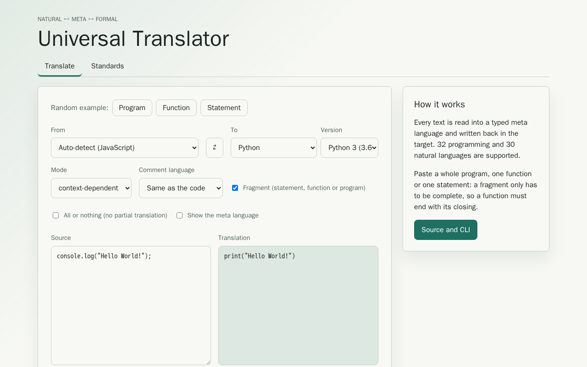
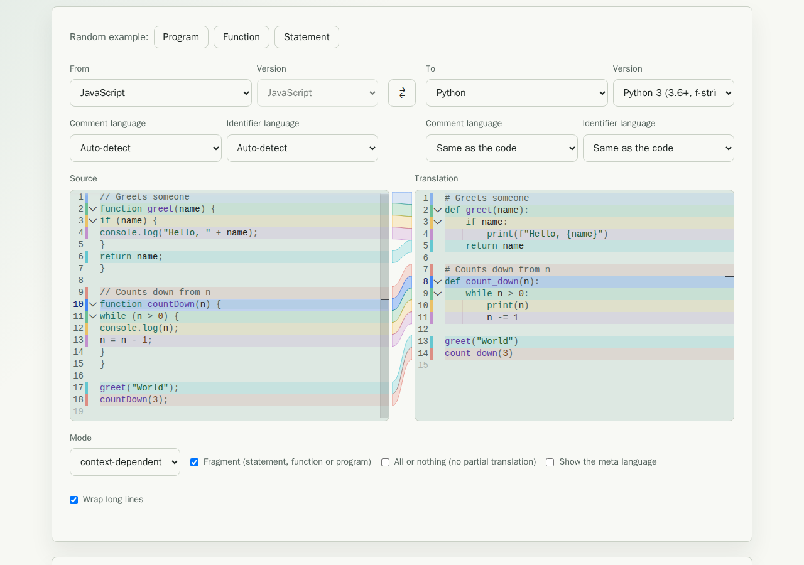

# Universal Example App

This example is the translator's web demo. It lists every programming and
natural language, reads a statement, a function or a whole program in the
source language and shows its translation, or the reason the text does not
parse. A fragment only has to be complete: a function must end with its
closing and a statement must be whole. The same build output is used for
GitHub Pages, Electron desktop packages, and Capacitor mobile projects.

```bash
npm run example:web:build
npm --prefix examples/universal-app run preview -- --port 4173 &
node examples/universal-app/e2e/translate.e2e.mjs http://127.0.0.1:4173/ web-demo.png
```



> The preview image above is regenerated automatically on every push to `main`
> by the `preview-regen` job in `.github/workflows/example-app.yml`. Run it
> locally with `npm run example:web:preview-images`.

## Editors

Both panes are [Monaco](https://microsoft.github.io/monaco-editor/) editors
by default. The settings also offer a plain text editor. Every language can
fold its regions: brackets, indented blocks and runs of comments, so this
works even for languages Monaco has no grammar for.

The editors are linked through the `lineMap` of the translation, which says
which source lines became which target lines:

- matching lines have the same background colour on both sides, and a strip
  between the editors joins them, as in diff tools and Compiler Explorer;
- the group under the cursor is highlighted in both editors;
- a selection, the cursor or a folded region on one side is shown on the
  other side too;
- scrolling one editor scrolls the other to the matching lines, and longer
  and shorter parts scroll in proportion.

Under each language picker are the natural languages of the comments and
identifiers. The source side's default is found from the text; on the
target side the default keeps the source's. The options used less often
(the mode, fragments, all-or-nothing, the meta language, word wrap) are
below the editors.



## Local Setup

```bash
npm ci
npm install --prefix examples/universal-app
```

## Web

```bash
npm run example:web:dev
npm run example:web:build
npm run example:web:preview
```

The Vite config uses `./` as the default asset base so the bundle also works
when loaded by Electron or copied into Capacitor. In GitHub Pages CI,
`GITHUB_PAGES=true` switches the base path to `/<repository>/`.

## Desktop

```bash
npm run example:desktop:package
npm run example:desktop:make
```

`desktop:package` creates a local Electron package under
`examples/universal-app/out`. `desktop:make` creates distributable artifacts
for the current platform. The GitHub Pages UI links to the latest GitHub
release so users can download desktop packages once release artifacts are
published.

## Mobile

Capacitor native projects are generated by downstream applications when they
are ready to customize app identifiers, icons, signing, and store metadata.

Android:

```bash
npm --prefix examples/universal-app run mobile:android:add
npm run example:mobile:sync
npm --prefix examples/universal-app run mobile:android:run
```

iOS:

```bash
npm --prefix examples/universal-app run mobile:ios:add
npm run example:mobile:sync
npm --prefix examples/universal-app run mobile:ios:run
```

You can test locally without an Apple Developer Program account by running the
iOS app in an Xcode simulator. Physical iOS devices and App Store/TestFlight
submission require Apple signing credentials. Android emulator or physical
device testing does not require a Google Play Console account, while Play Store
submission requires the normal Google Play signing and service account setup.

Set the repository variable `EXAMPLE_APP_ENABLE_ANDROID_BUILD=true` to
enable the Android CI build. The hosted desktop job packages the Ubuntu
app. Use the local Xcode steps above to build the iOS app.
